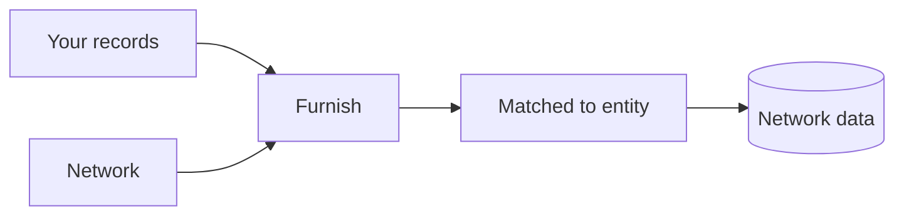
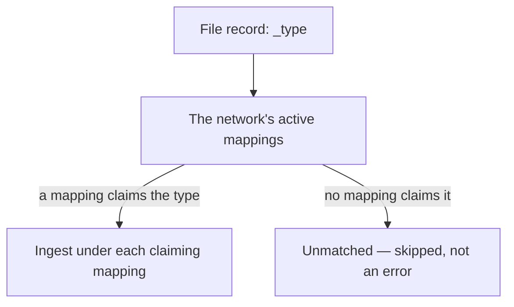

import DashboardFurnishingOverview from '/snippets/dashboard/furnishing-overview.mdx';

**Furnishing** is how a participant contributes verified work into a network.
It's the write half of the network: a verification your institution already
performed becomes a [trust asset](/concepts/trust/trust-assets) that backs
certificates for the participants entitled to read it.

## Contributing is asset creation, not data donation

The natural fear of contributing is "I'm giving away proprietary customer
intelligence and losing control." A SOLO network is designed so that isn't what
happens. When you furnish a verification, it becomes an **attributed, governed
asset**:

- **You keep attribution.** Every certificate sub-product your data backs
  carries your `furnishing_entity_id`. The verification travels with your name
  on it — see [Provenance](/concepts/trust/provenance).
- **You keep governance.** Contributed data is gated by the subject's
  [consent](/concepts/identity/consent), the network's
  [querying policy](/concepts/governance/querying-policies), and each reader's
  [entitlement](/concepts/governance/entitlement). Sharing a network with you
  does not let another member read what you furnished.
- **You keep read access.** Records you furnish are always readable to you, so
  they back your own certificates and queries.

## The furnishing channels

There are three ways to get records into a network. The differences are in
transport, batch size, and how much automation you want to build.

| | REST furnish | Dashboard upload | SFTP drops |
|---|---|---|---|
| **Endpoint / transport** | `POST /v1/products/kyc_certificate_snapshot/furnish`, `POST /v1/products/kyb_certificate_snapshot/furnish` | The SOLO dashboard | SFTP server (`sftp.solo.one`) |
| **Payload** | JSON records in the request body | A [JSONL file](/api-overview/furnishing/file-upload), or other formats through the **Furnish** dialog | JSONL files dropped into `jsonl_furnish_data/` |
| **Failure handling** | A failing record fails the whole request | Each record succeeds or fails on its own | Each record succeeds or fails on its own |
| **Processing** | Synchronous — the response reflects the furnish | Asynchronous — tracked on the Uploads page | Asynchronous — ingestion starts when the upload lands |
| **Best for** | Real-time furnishing from your onboarding flow | Occasional batches and historical loads | Recurring scheduled drops from core-banking or data-warehouse exports |

When to choose each:

- **REST furnish** when furnishing is an event in your system — a consumer
  finishes onboarding, you furnish their record in the same workflow. Lowest
  latency, immediate feedback, no file handling.
- **[Dashboard upload](/api-overview/furnishing/file-upload)** when you have a
  file in hand — a one-off historical load or a periodic batch you'd rather not
  automate.
- **[SFTP](/api-overview/sftp/overview)** when your data already leaves your
  systems as files on a schedule. Most core-banking and data-warehouse stacks
  can target an SFTP endpoint with no custom code.

<Note>
  REST furnish writes records directly in the product's shape; file records are
  turned into network data by the network's
  [furnishing policies](/concepts/governance/furnishing-policies). Every channel
  matches subjects on the same natural keys and attributes each record to your
  organization.
</Note>

## How a furnish works

A furnish brings together a **network**, your **records**, and the **consumer**
(or business) they describe:



| Concept | Role in the furnish |
|---|---|
| **Product** | *What* you're contributing over REST (a KYC or KYB certificate snapshot). Determines the endpoint and record schema. |
| **Network** | *Where* the data is contributed. You must be a [furnisher or governor](/concepts/governance/network-roles) of it. |
| **Mapping** | For files only: the network's [furnishing policy](/concepts/governance/furnishing-policies) that claims each record's `_type` and turns it into network data. |
| **Consumer / Business** | *Who* the data is about — matched from the identifiers in each record. |

### Anatomy of a REST furnish

You call the product's furnish endpoint with the network and one or more
records. For a KYC certificate:

```bash
curl -X POST https://api.sandbox.solo.one/v1/products/kyc_certificate_snapshot/furnish \
  -H "Authorization: Bearer $SOLO_TOKEN" \
  -H "Content-Type: application/json" \
  -d '{
    "network_id": "9f1c0c2e-7a44-4f1e-9d2a-08b6f3a1c5d7",
    "records": [
      {
        "first_name": "Jane",
        "last_name": "Doe",
        "date_of_birth": "1990-01-15",
        "social_security_number": "123-45-6789",
        "identity_corroboration_events": [
          { "is_kyc_cip": true, "is_ssn_match": true, "is_dob_match": true, "is_name_match": true }
        ]
      }
    ]
  }'
```

A successful furnish returns:

```json
{
  "success": true,
  "profile_ids": ["7c9e6679-7425-40de-944b-e07fc1f90ae7"],
  "counts": { "identity_corroboration_events": 1 }
}
```

Request fields:

- `network_id` — the network you're furnishing into. You must hold the
  furnisher or governor role there; otherwise the request fails with
  `403 PERMISSION_DENIED`.
- `records` — one or more consumer records. Each carries `first_name`,
  `last_name`, `date_of_birth`, and `social_security_number` (all required
  strings), plus optional lists of verification records:
  `document_capture_events`, `biometric_capture_events`,
  `liveness_check_events`, `identity_document_identities`,
  `identity_corroboration_events`, and `address_identities` (each address can
  carry its own `address_capture_events`). SSN and date of birth together are
  the key that matches the record to a consumer
  [entity](/concepts/identity/entities).

Response fields:

- `profile_ids` — the consumer or business profile each record resolved to, in
  the order you sent them.
- `counts` — how many rows were written per record type.

The response carries no furnish or submission id to look the request up later;
keep `profile_ids` if you need to refer back.

`POST /v1/products/kyb_certificate_snapshot/furnish` takes the same envelope
for business records. Each business record requires `federal_ein` and
`business_jurisdiction_of_formation` — together the business match key — and
can carry `business_legal_name`, `business_dba_name`, `business_email`, and
lists of `business_identity_verification_events`,
`business_ownership_control_verification_events`, and
`business_risk_compliance_events`.

<Warning>
  A REST furnish processes its records in order as one unit. If any record
  fails, the request returns an error and **none** of its records are saved.
  Fix the failing record and resend the whole request.
</Warning>

### How file records reach a mapping

You never name a mapping in a file. Each record's `_type` does it: the network's
active [furnishing policies](/concepts/governance/furnishing-policies) (mappings)
each claim a record type, and every record goes to each mapping that claims its
type. Records no mapping claims are counted as unmatched — skipped without being
treated as errors.



As a furnisher you state *facts* (network, record type, record); the network's
mappings decide *rules*. See
[record types](/api-overview/furnishing/file-upload#record-types) for the
details.

## What happens after ingest

Once a record is accepted, the furnishing pipeline takes over:

1. **Validation.** REST records are checked against the product's record
   schema; file records against the mapping that claimed them. In a file, each
   record is processed independently — one bad record doesn't fail its
   neighbors. Over REST, a failing record fails the request.
2. **Entity matching.** The record's natural key (SSN and date of birth for
   consumers; federal EIN and jurisdiction of formation for businesses) is
   matched to an existing [entity](/concepts/identity/entities), or a new
   profile is created. A matched profile keeps its existing identity fields.
3. **Records become network data.** The furnished verification events are
   written against that subject, stamped with the network and attributed to
   your organization.
4. **Certificates.** For certificate products, the furnished events become the
   evidence behind the KYC/KYB certificates built from them, each sub-product
   carrying your `furnishing_entity_id`.
5. **Entitlement is recorded.** SOLO records which records the furnish wrote
   or matched for the subject, attributed to your organization — see
   [Entitlement](/concepts/governance/entitlement).

## Data quality expectations

The network is only as good as what's furnished into it. A few expectations
hold across every channel:

- **Identifiers must be real and complete.** SSNs, EINs, and dates of birth
  are matching keys. A typo doesn't just corrupt one record — it creates a
  phantom profile or attaches data to the wrong one.
- **Treat identifiers as text.** SSNs and tax identifiers are strings, not
  numbers. Exporting them as JSON numbers silently drops leading zeros.
- **Furnish what the certificate needs.** Certificates are built from specific
  verification events. Records that don't carry them won't produce
  certificates, even if they ingest cleanly.
- **Re-sending is safe for identities, not for events.** A record with the
  same natural key matches the existing profile rather than creating a
  duplicate — but the verification events it carries are added again as new
  events. Re-send only records whose events weren't saved, and don't "fix" a
  bad record by changing its identifiers.

## Mapping dry-run tools

Mappings are saved and activated in the dashboard. Four REST endpoints let you
check a mapping document from your own tooling first. They are **dry-run
only**: none of them reads network data or saves anything.

| Endpoint | What it does |
|---|---|
| `POST /v1/furnishing/mapping/verify` | Verifies a mapping document (`mapping`) against the schemas of its sources (`roots`) and an optional `target`. Returns `ok` plus `errors`, `lints`, and `deferred` findings. |
| `POST /v1/furnishing/mapping/trace` | Runs a mapping over one sample input (`input`) and returns the `result` and a `trace` of the value at each step. The mapping must verify first, or the call returns `400`. |
| `POST /v1/furnishing/mapping/suggest` | Asks an AI model to suggest a mapping document for one entry. Returns the suggested `document`, whether it `verified`, and the target fields it deliberately left unmapped (`omissions`), rather than inventing values. |
| `POST /v1/furnishing/mapping/propose` | Proposes every mapping document a pipeline default (`source_default_slug`) needs from one sample record (`sample`) and its inferred schema (`row_schema`). Returns the proposed `config_values`, the field-by-field `rows` with previews, and the required fields nothing binds (`blocking_missing`). Send earlier `config_values` back to re-check them without calling the model. |

<Note>
  **AI-assisted endpoints.** `suggest` and `propose` use an AI model provided by
  Anthropic. By default the model sees only the **structure** of your data —
  field names and types — never the values. Values are sent to the model only
  when you opt in: `"mode": "structure_with_sample"` on `suggest`, or
  `"share_sample_with_model": true` on `propose`. `propose` always evaluates the
  sample on SOLO's servers to show previews, whether or not it is shared with
  the model.
</Note>

## Furnishing vs. querying

| | Furnishing | Querying |
|---|---|---|
| Direction | Write into the network | Read from the network |
| Needs consent? | No | Yes — or a direct identity lookup |
| Needs a policy you pass? | No (file records route by `_type`) | Optional (`policy_id`) |
| Records entitlement? | Yes | Yes, when a certificate is issued |

See [Querying](/api-overview/querying/overview) for the read half.

## Troubleshooting

<AccordionGroup>
  <Accordion title="403 / not authorized to furnish">
    Your organization must hold the furnisher or governor role in the target
    network. See [network roles](/concepts/governance/network-roles). Check
    that `network_id` is the network where you were granted the role — roles
    don't carry across networks.
  </Accordion>
  <Accordion title="A REST furnish failed partway through a batch">
    Nothing from that request was saved. Fix the record the error names and
    resend the whole request.
  </Accordion>
  <Accordion title="File accepted but no certificate appears">
    Most often the records were **unmatched**: no active mapping in the target
    network claims their `_type`. Unmatched records are skipped deliberately,
    not errored. The upload's results name the unmatched types — compare them
    with the record types your network's feeds declare.
  </Accordion>
  <Accordion title="Validation errors on individual records">
    Common causes: missing required fields (all four consumer identity fields
    are required over REST), malformed dates (use ISO 8601, e.g.
    `1990-01-15`), or empty identifier strings.
  </Accordion>
  <Accordion title="Duplicate entities after furnishing">
    Entity matching keys on SSN and date of birth for consumers, and federal EIN
    and jurisdiction of formation for businesses. If you see duplicates, the
    identifiers differed between submissions — check for formatting drift such
    as dropped leading zeros, embedded whitespace, or a different date format.
  </Accordion>
</AccordionGroup>

<DashboardFurnishingOverview />

## Related concepts

<CardGroup cols={2}>
  <Card title="JSONL Files" icon="file-arrow-up" href="/api-overview/furnishing/file-upload">
    Furnish whole files of records from the dashboard.
  </Card>
  <Card title="SFTP Ingestion" icon="server" href="/api-overview/sftp/overview">
    Recurring JSONL drops, no HTTP client required.
  </Card>
  <Card title="Furnishing Policies" icon="scale-balanced" href="/concepts/governance/furnishing-policies">
    The rules the network applies to what you contribute.
  </Card>
  <Card title="Furnish an entity" icon="rocket" href="/home/quickstart/furnish-an-entity">
    A hands-on walkthrough of your first furnish.
  </Card>
</CardGroup>
