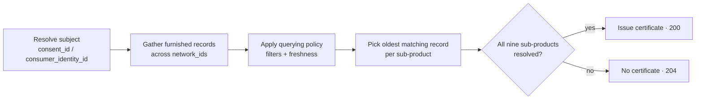

import DashboardQueryingKycCertificateSnapshot from '/snippets/dashboard/querying-kyc-certificate-snapshot.mdx';


The **KYC Certificate Snapshot** is a reusable identity-verification
certificate for consumer onboarding. A query assembles the verification work
that network participants have already furnished for a consumer (document
capture and review, biometrics, liveness, address, and identity corroboration)
into a single network-issued certificate.

The certificate supports, and does not replace, your institution's own
Customer Identification Program. Whether and how far to rely on a certificate
remains your institution's decision.

| | |
|---|---|
| **Category** | Identity Verification |
| **Use case** | Customer Onboarding |
| **Subject** | Consumer |
| **Operations** | `POST /v1/products/kyc_certificate_snapshot/query`, `POST /v1/products/kyc_certificate_snapshot/query/soft`, `POST /v1/products/kyc_certificate_snapshot/furnish` |

## What's in the certificate

A KYC certificate consists of nine **sub-products**, each a block in the query
response with its own `assertions` (what was attested, and when) and `data`
(the supporting attributes). A certificate is issued only when all nine
resolve.

| Sub-product | Response key | What it carries |
|---|---|---|
| Document capture | `document_capture` | An identity document was captured: document type, number, issuing state, issue and expiration dates, capture method. |
| Document review | `document_review` | The document was reviewed: review method and evidence source, tamper review, machine-readable-data validation. |
| Biometric capture | `biometric_capture` | A biometric (e.g. a selfie) was captured, with capture method. |
| Biometric review | `biometric_review` | The biometric was compared against a reference, with image quality and outcome. |
| Liveness capture | `liveness_capture` | Liveness evidence was captured, with the capture environment. |
| Liveness review | `liveness_review` | The liveness evidence was reviewed, with method, outcome, and confidence tier. |
| Address capture | `address_capture` | An address was captured, with the capture timestamp. |
| Address verification | `address_verification` | The address was verified, with method, outcome, and deliverability. |
| Identity corroboration | `identity_corroboration` | Identity elements (SSN, date of birth, name, address, phone, email) were corroborated, with methods, outcome, and number of sources consulted. |

Each sub-product is resolved independently, so different sub-products can come
from different furnishing institutions. Each carries the `furnishing_entity_id`
and `attestation_event_id` of the furnished record that backed it.

## Querying

```bash
curl -X POST https://api.sandbox.solo.one/v1/products/kyc_certificate_snapshot/query \
  -H "Authorization: Bearer $SOLO_TOKEN" \
  -H "Content-Type: application/json" \
  -d '{
    "consent_id": "a3f0b9c7-…",
    "policy_id": "5e7d2a14-…",
    "network_ids": ["9f1c0c2e-…"]
  }'
```

The request follows the standard [query anatomy](/api-overview/querying/overview#anatomy-of-a-query):
identify the subject with `consent_id` *or* `consumer_identity_id` (not both),
and scope the read with `network_ids` plus an optional `policy_id` and
`furnishing_entity_ids`. If you omit `policy_id`, the policy assigned to the
first network in `network_ids` is applied.

A `200 OK` means a certificate was issued:

```json
{
  "certificate_id": "1c9f4e2a-…",
  "provenance_event_id": "7b2d9c4e-…",
  "consumer_identity_id": "c2a4e8d0-…",
  "result": {
    "meta": {
      "network_id": "9f1c0c2e-…",
      "policy_id": "5e7d2a14-…"
    },
    "document_capture": {
      "furnishing_entity_id": "e1d2c3b4-…",
      "attestation_event_id": "f0a1b2c3-…",
      "assertions": {
        "document_capture_assertion": true,
        "document_capture_timestamp": "2026-04-15T00:00:00Z"
      },
      "data": {
        "document_artifact": "passport_scan.pdf",
        "document_type": "us_passport",
        "document_issuing_state": "NY",
        "document_number": "934712385",
        "document_issue_date": "2021-03-02",
        "document_expiration_date": "2031-03-02",
        "document_capture_method": "mobile_live_capture"
      }
    },
    "document_review": {
      "furnishing_entity_id": "e1d2c3b4-…",
      "attestation_event_id": "f0a1b2c3-…",
      "assertions": {
        "document_attribute_review_assertion": true,
        "document_attribute_review_timestamp": "2026-04-16T00:00:00Z"
      },
      "data": {
        "document_review_method": "automated_and_manual",
        "document_review_evidence_source": "document_issuer",
        "document_tamper_review_performed": true,
        "document_tamper_indicators_observed": false,
        "is_document_machine_readable_data_validation_performed": true,
        "is_document_machine_readable_data_validation_consistent_with_document_face": true
      }
    },
    "biometric_capture": {
      "furnishing_entity_id": "e1d2c3b4-…",
      "attestation_event_id": "a7c3e9f1-…",
      "assertions": {
        "biometric_capture_assertion": true,
        "biometric_capture_timestamp": "2026-04-15T00:00:00Z"
      },
      "data": {
        "biometric_artifact": "selfie.jpg",
        "biometric_capture_method": "live_selfie_video",
        "biometric_artifact_subject_present": true
      }
    },
    "biometric_review": {
      "furnishing_entity_id": "e1d2c3b4-…",
      "attestation_event_id": "a7c3e9f1-…",
      "assertions": {
        "biometric_review_assertion": true,
        "biometric_review_timestamp": "2026-04-15T00:00:00Z"
      },
      "data": {
        "is_biometric_comparison_performed": true,
        "biometric_comparison_evidence_source": "commercial_verification_provider",
        "biometric_image_quality_sufficient_for_comparison": true,
        "biometric_artifact_image_quality": "high",
        "biometric_comparison_reference": "document_photo_same_session",
        "biometric_comparison_outcome": "full_match"
      }
    },
    "liveness_capture": {
      "furnishing_entity_id": "e1d2c3b4-…",
      "attestation_event_id": "b8d4f0a2-…",
      "assertions": {
        "liveness_capture_assertion": true,
        "liveness_capture_timestamp": "2026-04-15T00:00:00Z"
      },
      "data": {
        "liveness_artifact": "liveness_capture.mp4",
        "liveness_capture_environment": "remote_unsupervised"
      }
    },
    "liveness_review": {
      "furnishing_entity_id": "e1d2c3b4-…",
      "attestation_event_id": "b8d4f0a2-…",
      "assertions": {
        "liveness_review_assertion": true,
        "liveness_review_timestamp": "2026-04-15T00:00:00Z"
      },
      "data": {
        "liveness_review_method": "passive_liveness",
        "liveness_review_outcome": "live_person_confirmed",
        "liveness_review_confidence_tier": "high",
        "liveness_review_evidence_source": "commercial_verification_provider"
      }
    },
    "address_capture": {
      "furnishing_entity_id": "d4c3b2a1-…",
      "attestation_event_id": "c9e5a1b3-…",
      "assertions": {
        "address_capture_assertion": true,
        "address_capture_timestamp": "2026-04-10T00:00:00Z"
      },
      "data": {
        "address_category": "residential"
      }
    },
    "address_verification": {
      "furnishing_entity_id": "d4c3b2a1-…",
      "attestation_event_id": "c9e5a1b3-…",
      "assertions": {
        "address_verification_assertion": true,
        "address_verification_timestamp": "2026-04-11T00:00:00Z"
      },
      "data": {
        "address_verification_methods": ["credit_bureau_match"],
        "address_verification_outcomes": ["full_match"],
        "total_address_sources_consulted": null,
        "address_source_count_full_match": null,
        "address_source_count_inconclusive": null,
        "address_source_count_no_match": null,
        "address_source_count_partial_match_street_and_city_only": null,
        "address_source_count_partial_match_zip_only": null,
        "address_deliverable": true
      }
    },
    "identity_corroboration": {
      "furnishing_entity_id": "e1d2c3b4-…",
      "attestation_event_id": "d0f6b2c4-…",
      "assertions": {
        "is_identity_corroboration_performed": true,
        "identity_corroboration_timestamp": "2026-04-16T09:30:00Z"
      },
      "data": {
        "identity_elements_corroborated": "ssn, dob, name",
        "identity_corroboration_methods": ["credit_bureau_match", "public_records_match"],
        "identity_corroboration_outcomes": ["full_match"],
        "total_identity_corroboration_sources_consulted": 2,
        "identity_corroboration_source_count_full_match": null,
        "identity_corroboration_source_count_inconclusive": null,
        "identity_corroboration_source_count_no_match": null,
        "identity_corroboration_source_count_partial_match": null
      }
    }
  }
}
```

- `certificate_id`: the issued certificate. The certificate records its issue
  date, its attestation timestamp, and the networks and policy it was resolved
  under.
- `provenance_event_id`: the billable query event id; the same value is
  returned in the `X-Ref-Id` response header. Quote it to support and keep it in
  your audit log.
- `result`: the consolidated certificate. On a `200`, all nine sub-products are
  present.
- `result.meta`: the anchor `network_id` and the `policy_id` that was applied
  (`null` when catalog defaults applied).

Some fields currently carry fixed or empty values rather than furnished data:

| Field | Current behavior |
|---|---|
| `address_capture.data.address_category` | Always `residential`. It does not reflect a furnished address type. |
| `liveness_capture.data.liveness_artifact` | Always `liveness_capture.mp4`, a fixed placeholder. It does not reference the furnished liveness artifact. |
| `address_verification.data.total_address_sources_consulted` and `address_source_count_*` | Always `null`. Furnishers report one method and outcome per address verification. |
| `identity_corroboration.data.identity_corroboration_source_count_*` | Always `null`. Furnishers report one outcome per corroboration, not one per source consulted. |

## How the certificate resolves across networks



The query gathers furnished records across every network in `network_ids` and
applies one querying policy to all of them: the `policy_id` you pass, or the
policy assigned to the first network. For each sub-product it selects the
**oldest matching record** from any listed network, and the result's
`meta.network_id` is anchored to the **first** network in your request. List
your primary network first.

## When you get a 204

The endpoint returns `204 No Content` when *no certificate could be created
because the available data did not satisfy the policy*. Concretely, a `204` is
returned when:

- any of the nine sub-products has no furnished record in
  the queried networks that passes the policy's filters, for example because
  it was never furnished, or the record is outside the policy's freshness
  window, or
- you passed an explicit `policy_id` that selects specific data fields, and the
  resolved certificate leaves one of those fields empty.

The body is empty. The response still carries the `X-Ref-Id` header, and the
query is still a recorded, billable event.

## Soft check before you query

`POST /v1/products/kyc_certificate_snapshot/query/soft` takes the **same
request body** as the query and runs the same resolution, as a non-billable
dry run. It issues no certificate, records no query event, and returns no
subject data values. On success it always returns `200 OK` with a body, never
`204`:

```bash
curl -X POST https://api.sandbox.solo.one/v1/products/kyc_certificate_snapshot/query/soft \
  -H "Authorization: Bearer $SOLO_TOKEN" \
  -H "Content-Type: application/json" \
  -d '{
    "consent_id": "a3f0b9c7-…",
    "policy_id": "5e7d2a14-…",
    "network_ids": ["9f1c0c2e-…"]
  }'
```

```json
{
  "issuable": false,
  "missing_data_paths": ["document_capture.data.document_type"],
  "matched_models": [
    "AddressCaptureEvent",
    "BiometricCaptureEvent",
    "DocumentCaptureEvent",
    "IdentityCorroborationEvent",
    "LivenessCheckEvent"
  ]
}
```

| Field | Meaning |
|---|---|
| `issuable` | Whether the same query, run now, would issue a certificate (`200`) rather than return `204`. |
| `missing_data_paths` | The sub-products that didn't resolve (for example `liveness_capture`), plus any data fields selected by an explicit `policy_id` that would be empty. Empty when `issuable` is `true`. |
| `matched_models` | The product models whose capture-side sub-product resolved (for example `DocumentCaptureEvent` for `document_capture`). Review sub-products are not listed separately; if one would be absent, `issuable` is `false`. |

The soft check uses the same subject resolution as the query, so it returns the
same `400`, `403`, and `404` errors. The furnished data can change between the
soft check and the query, so `issuable: true` is not a guarantee.

## Furnishing

Participants contribute the underlying KYC data with
`POST /v1/products/kyc_certificate_snapshot/furnish`. You must be a furnisher or
governor of `network_id`. Each record needs `first_name`, `last_name`,
`date_of_birth`, and `social_security_number`, and can nest verification events
(`document_capture_events`, `biometric_capture_events`, `liveness_check_events`,
`identity_document_identities`, `identity_corroboration_events`,
`address_identities`):

```json
{
  "network_id": "9f1c0c2e-…",
  "records": [
    {
      "first_name": "Jane",
      "last_name": "Doe",
      "date_of_birth": "1990-01-15",
      "social_security_number": "123-45-6789",
      "document_capture_events": [
        {
          "is_document_captured": true,
          "document_capture_timestamp": "2026-04-15",
          "document_capture_method": "mobile_live_capture"
        }
      ]
    }
  ]
}
```

The response lists the profile each record was matched to (or created as), in
request order, and the number of rows persisted per event type:

```json
{
  "success": true,
  "profile_ids": ["c2a4e8d0-…"],
  "counts": { "document_capture_events": 1 }
}
```

Bulk contribution is also available via
[file upload](/api-overview/furnishing/file-upload) and
[SFTP](/api-overview/sftp/overview); see [Furnishing](/api-overview/furnishing/overview)
for the full model.

## Field reference

The KYC certificate's data dictionary, model by model. *Field* is the display
name, *API name* is the `field_name` used in querying policies, the soft check,
and coverage checks.

### ConsumerIdentity

| Field | API name | Type |
|---|---|---|
| First Name | `first_name` | String |
| Last Name | `last_name` | String |

### DocumentCaptureEvent

| Field | API name | Type |
|---|---|---|
| Attestation ID | `attestation_event_id` | UUID |
| Furnishing Entity ID | `furnishing_entity_id` | UUID |
| Is Document Captured | `is_document_captured` | Boolean |
| Document Capture Timestamp | `document_capture_timestamp` | Date |
| Is Document Attribute Reviewed | `is_document_attribute_reviewed` | Boolean |
| Document Attribute Review Timestamp | `document_attribute_review_timestamp` | Date |
| Document Capture Method | `document_capture_method` | String |
| Document Review Method | `document_review_method` | String |
| Document Review Evidence Source | `document_review_evidence_source` | String |

### IdentityDocumentIdentity

| Field | API name | Type |
|---|---|---|
| Identity Document Type | `type` | String |
| Document Issue Date | `issue_date` | Date |
| Document Expiration Date | `expiration_date` | Date |
| Issuing Authority | `issuing_authority` | String |
| Issuing State | `issuing_state` | String |
| Is Document Tamper Review Performed | `is_document_tamper_review_performed` | Boolean |
| Document Tamper Review Outcome | `document_tamper_review_outcome` | String |
| Is Machine-Readable Data Validation Performed | `is_machine_readable_data_validation_performed` | Boolean |
| Is Machine-Readable Data Consistent With Document Face | `is_machine_readable_data_consistent_with_document_face` | Boolean |
| Are Security Features Verified | `are_security_features_verified` | Boolean |
| Document Number | `number` | String |
| Document Upload | `upload` | String |

### BiometricCaptureEvent

| Field | API name | Type |
|---|---|---|
| Attestation ID | `attestation_event_id` | UUID |
| Furnishing Entity ID | `furnishing_entity_id` | UUID |
| Is Biometric Captured | `is_biometric_captured` | Boolean |
| Biometric Capture Timestamp | `biometric_capture_timestamp` | Date |
| Is Biometric Attribute Reviewed | `is_biometric_attribute_reviewed` | Boolean |
| Biometric Attribute Review Timestamp | `biometric_attribute_review_timestamp` | Date |
| Biometric Capture Method | `biometric_capture_method` | String |
| Is Biometric Comparison Performed | `is_biometric_comparison_performed` | Boolean |
| Biometric Comparison Evidence Source | `biometric_comparison_evidence_source` | String |
| Biometric Comparison Reference | `biometric_comparison_reference` | String |
| Biometric Comparison Outcome | `biometric_comparison_outcome` | String |
| Biometric Artifact Type | `biometric_artifact_type` | String |
| Biometric Artifact Image Quality | `biometric_artifact_image_quality` | String |
| Biometric Artifact Subject Present | `biometric_artifact_subject_present` | Boolean |
| Biometric Artifact Upload | `biometric_artifact_upload` | String |

### LivenessCheckEvent

| Field | API name | Type |
|---|---|---|
| Attestation ID | `attestation_event_id` | UUID |
| Furnishing Entity ID | `furnishing_entity_id` | UUID |
| Is Liveness Captured | `is_liveness_captured` | Boolean |
| Capture Timestamp | `capture_timestamp` | Date |
| Is Liveness Evidence Reviewed | `is_liveness_evidence_reviewed` | Boolean |
| Evidence Review Timestamp | `evidence_review_timestamp` | Date |
| Capture Method Type | `capture_method_type` | String |
| Liveness Capture Environment | `liveness_capture_environment` | String |
| Liveness Review Evidence Source | `liveness_review_evidence_source` | String |
| Check Result | `check_result` | String |
| Evidence Clarity | `evidence_clarity` | String |

### AddressCaptureEvent

| Field | API name | Type |
|---|---|---|
| Attestation ID | `attestation_event_id` | UUID |
| Furnishing Entity ID | `furnishing_entity_id` | UUID |
| Is Address Captured | `is_address_captured` | Boolean |
| Address Capture Timestamp | `address_capture_timestamp` | Date |
| Is Address Verified | `is_address_verified` | Boolean |
| Address Verification Timestamp | `address_verification_timestamp` | Date |
| Address Verification Method Type | `address_verification_method_type` | String |
| Address Verification Outcome | `address_verification_outcome` | String |
| Deliverable | `deliverable` | Boolean |

### IdentityCorroborationEvent

| Field | API name | Type |
|---|---|---|
| Attestation ID | `attestation_event_id` | UUID |
| Furnishing Entity ID | `furnishing_entity_id` | UUID |
| Is KYC CIP | `is_kyc_cip` | Boolean |
| Identity Corroboration Timestamp | `identity_corroboration_timestamp` | Datetime |
| Identity Corroboration Methods | `identity_corroboration_methods` | String |
| Identity Corroboration Outcome | `identity_corroboration_outcome` | String |
| Total Identity Corroboration Sources Consulted | `total_identity_corroboration_sources_consulted` | Integer |
| KYC Decision | `kyc_decision` | String |
| Is SSN Match | `is_ssn_match` | Boolean |
| Is Name Match | `is_name_match` | Boolean |
| Name Verified | `name_verified` | Boolean |
| Is DOB Match | `is_dob_match` | Boolean |
| SSN Verified | `ssn_verified` | Boolean |
| Is Address Match | `is_address_match` | Boolean |
| Is Phone Match | `is_phone_match` | Boolean |
| Is Email Match | `is_email_match` | Boolean |

### KYCCertificateSnapshot (policy configuration only)

These certificate-level fields appear when configuring a
[querying policy](/concepts/governance/querying-policies). They are not
projected into the query response, and they are not applied when a query
resolves: each successful query issues a new certificate dated the day it is
issued.

| Field | API name | Type |
|---|---|---|
| Certificate As Of Date | `certificate_as_of_date` | Date |
| Certificate Attestation Timestamp | `certificate_attestation_timestamp` | Datetime |
| Days Since Certificate As Of Date | `days_since_certificate_as_of_date` | Integer |
| Is Address Captured | `is_address_captured` | Boolean |
| Is Address Verification Performed | `is_address_verification_performed` | Boolean |
| Is Biometric Captured | `is_biometric_captured` | Boolean |
| Is Biometric Reviewed | `is_biometric_reviewed` | Boolean |
| Is Document Captured | `is_document_captured` | Boolean |
| Is Document Reviewed | `is_document_reviewed` | Boolean |
| Is Identity Corroboration Performed | `is_identity_corroboration_performed` | Boolean |
| Is Liveness Captured | `is_liveness_captured` | Boolean |
| Is Liveness Reviewed | `is_liveness_reviewed` | Boolean |

## Related


<DashboardQueryingKycCertificateSnapshot />
<CardGroup cols={2}>
  <Card title="Querying" icon="magnifying-glass" href="/api-overview/querying/overview">
    Request anatomy, 200 vs 204, billing, and the X-Ref-Id header.
  </Card>
  <Card title="Coverage check" icon="list-radio" href="/api-overview/querying/coverage-check">
    See which institutions have furnished which fields for a subject.
  </Card>
</CardGroup>
