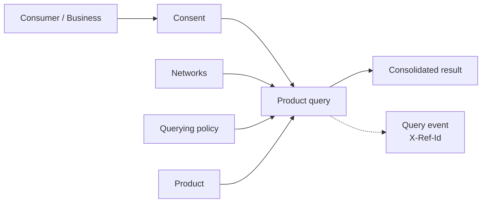

import DashboardQueryingOverview from '/snippets/dashboard/querying-overview.mdx';

**Querying** is how a participant consumes the network: it reads consolidated,
already-furnished verification data about a subject instead of re-collecting
it. A single query brings together four concepts (a **network**, a **policy**,
a **product**, and a **consumer** or business), gated by **consent**.

## Why consume network data

You query to reuse work, not to "buy data." A query returns a
[trust asset](/concepts/trust/trust-assets), an attested verification with its
provenance intact:

- **Faster onboarding.** Reuse a [KYC](/api-overview/querying/kyc-certificate-snapshot)
  or [KYB](/api-overview/querying/kyb-certificate-snapshot) certificate instead of
  repeating document collection and review.
- **Less manual review.** Start from another institution's evidenced
  verification rather than from zero.
- **Do only the missing work.** The non-billable
  [soft check](/api-overview/querying/kyc-certificate-snapshot#soft-check-before-you-query)
  and [coverage check](/api-overview/querying/coverage-check) show what already
  exists, so you collect only what's absent.

Reliance decisions stay with you: network data supports your own programs, and
your institution decides how far to rely on it.

## How querying works



| Concept | Role in the query |
|---|---|
| **Product** | *What* you're reading (e.g. a KYC certificate). Determines the endpoint and schema. See the [product catalog](/api-overview/querying/products). |
| **Network** | *Where* you're reading from. You must be a member of every [network](/concepts/governance/networks) you include. |
| **Policy** | *Which rules* apply: the [querying policy](/concepts/governance/querying-policies) that filters which furnished records a certificate may use, including how fresh they must be. |
| **Consumer / Business** | *Who* the query is about, resolved from your [consent](/concepts/identity/consent) record or a direct profile reference. |

## Anatomy of a query

Every product query is a `POST` to the product's `/query` endpoint. The request
body has two halves: **who** the query is about, and **where and under which
rules** to read.

| Field | Type | Required | Purpose |
|---|---|---|---|
| `consent_id` | string | one of¹ | Consent token identifying the subject. See [Consent](/concepts/identity/consent). |
| `consumer_identity_id` / `business_identity_id` | UUID | one of¹ | Direct profile reference, as an alternative to `consent_id`. Consumer products take `consumer_identity_id`; the KYB certificate takes `business_identity_id`. |
| `network_ids` | UUID[] | yes | One or more networks to read across. The first network anchors the result. |
| `policy_id` | UUID | no | The [querying policy](/concepts/governance/querying-policies) to apply across every network in `network_ids`. If omitted, the policy currently assigned to the **first** network in `network_ids` is applied; if that network has none, the product's catalog defaults apply. If passed, it must be a policy of the first network in `network_ids` that's available to you: the network's current default, one your sponsor bank assigned to your organization, or, if you govern the network, any of its policies. Certificate queries only. |
| `furnishing_entity_ids` | UUID[] | no | Limit the read to data from these furnishing institutions. When omitted or empty, all furnishers are considered. |

¹ Provide exactly one: a `consent_id` *or* a direct profile id. Sending both,
or neither, returns `400 VALIDATION_ERROR`.

Why both halves matter:

- The **subject** half identifies who the query is about. With `consent_id`,
  the consent record documents the subject's permission and resolves their
  identity, so you never resend personal details on each call.
- The **scope** half (`network_ids` and `policy_id`) tells the network where to
  read and which filters to apply. The same product can return different
  results under different policies.

<Note>
  Each issued certificate records the networks and the policy it was resolved
  under, so the scope you pass is part of the audit trail.
</Note>

### Full example

```bash
curl -X POST https://api.sandbox.solo.one/v1/products/kyc_certificate_snapshot/query \
  -H "Authorization: Bearer $SOLO_TOKEN" \
  -H "Content-Type: application/json" \
  -d '{
    "consent_id": "a3f0b9c7-…",
    "policy_id": "5e7d2a14-…",
    "network_ids": ["9f1c0c2e-…"]
  }'
```

A successful query returns `200 OK` with the consolidated result and an
`X-Ref-Id` response header. Abridged here to one sub-product; a `200` always
carries every sub-product (see the
[full KYC example](/api-overview/querying/kyc-certificate-snapshot#querying)):

```json
{
  "certificate_id": "1c9f4e2a-…",
  "provenance_event_id": "7b2d9c4e-…",
  "consumer_identity_id": "c2a4e8d0-…",
  "result": {
    "meta": {
      "network_id": "9f1c0c2e-…",
      "policy_id": "5e7d2a14-…"
    },
    "document_capture": {
      "furnishing_entity_id": "e1d2c3b4-…",
      "attestation_event_id": "f0a1b2c3-…",
      "assertions": {
        "document_capture_assertion": true,
        "document_capture_timestamp": "2026-04-15T00:00:00Z"
      },
      "data": {
        "document_artifact": "passport_scan.pdf",
        "document_type": "us_passport",
        "document_issuing_state": "NY",
        "document_number": "934712385",
        "document_issue_date": "2021-03-02",
        "document_expiration_date": "2031-03-02",
        "document_capture_method": "mobile_live_capture"
      }
    }
  }
}
```

The shape of `result` is product-specific. See the per-product pages for the
[KYC certificate](/api-overview/querying/kyc-certificate-snapshot),
[KYB certificate](/api-overview/querying/kyb-certificate-snapshot), and
[screening lists](/api-overview/querying/screening-lists).

`result.meta` records how the result was resolved: the anchor `network_id` and
the `policy_id` that was applied (explicit or assigned; `null` when catalog
defaults applied).

## 200 vs 204

Certificate query endpoints distinguish two successful outcomes:

| Status | Meaning | Body |
|---|---|---|
| `200 OK` | The query resolved and a certificate was issued. | The product's response schema. |
| `204 No Content` | The query resolved, but the furnished data did not satisfy the policy, so no certificate was created. | **Empty.** |

`204` is not an error. It means the network looked, applied the policy, and
found the furnished data falls short. For example, a required sub-product was
never furnished, or the data is older than the policy's freshness window
allows. Treat `204` as "queried, nothing to show."

Screening lists never return `204`; a clean result is `200` with
`"is_listed": false`.

<Note>
  A `204` response still carries the `X-Ref-Id` header, because the query
  itself was resolved and recorded. To avoid paying for predictable `204`s, run
  the non-billable [soft check](/api-overview/querying/kyc-certificate-snapshot#soft-check-before-you-query)
  (`POST /v1/products/{kyc,kyb}_certificate_snapshot/query/soft`) first.
</Note>

## The `X-Ref-Id` header

Every product query response, `200` and `204` alike, includes an `X-Ref-Id`
response header. Its value is the **query event id**: the durable identifier of
this query in the network's audit trail. On `200` responses the same value also
appears in the body as `provenance_event_id`.

```text
HTTP/1.1 200 OK
X-Ref-Id: 7b2d9c4e-…
Content-Type: application/json
```

Treat it like a receipt:

- **Quote it to support.** It lets SOLO trace the exact request, the policy
  applied, and the data considered.
- **Store it in your own audit log.** It ties your internal decision record to
  the network's record of the same event.
- **Reconcile billing.** Each billable query corresponds to one query event id.

## What you get back

A product query reads data furnished to the networks you list in
`network_ids` (narrowed by `furnishing_entity_ids` if you pass it) and, for
certificates, filtered by the applied querying policy. Issuing a certificate
also records [entitlement](/concepts/governance/entitlement) links for the
records it used.

## Billing

- Every call to a product's `/query` endpoint that resolves is recorded as a
  query event and is billable. For certificates this includes `204`
  responses; for screening lists it includes `"is_listed": false` results.
- The certificate soft check (`POST /v1/products/{kyc,kyb}_certificate_snapshot/query/soft`)
  and the [coverage check](/api-overview/querying/coverage-check)
  (`POST /v1/products/check`) are **not** billable and record no query event.
- Pricing is not covered in this documentation.

<Warning>
  A `204 No Content` response is still a resolved, billable query. If your
  integration retries on `204`, every retry is another billable event. Use the
  soft check to avoid querying subjects whose data cannot satisfy your policy.
</Warning>

## Multi-network queries

`network_ids` accepts more than one network, letting a single call read across
several networks you belong to:

```json
{
  "consent_id": "a3f0b9c7-…",
  "policy_id": "5e7d2a14-…",
  "network_ids": ["9f1c0c2e-…", "4d8a7f31-…"]
}
```

How a multi-network certificate query resolves:

- One policy applies to **every** network listed: the `policy_id` you pass, or,
  if omitted, the policy assigned to the first network in `network_ids`.
- Data is gathered from all listed networks; for each sub-product the query
  selects the oldest matching record from any listed network.
- The result's `meta.network_id` is **anchored to the first network** in
  `network_ids`; list your primary network first.
- You must be a member of every network listed. A network you can't access
  fails the request rather than being silently skipped.

## How consent ties in

Every query identifies its subject with a `consent_id` or a direct profile id.

<Steps>
  <Step title="Gather permission and record consent">
    Create a consent record for the subject in a network and receive a
    `consent_id`. See [Consent](/concepts/identity/consent).
  </Step>
  <Step title="Reference the consent on each query">
    Pass the `consent_id` in the query body, with the consent's network among
    the `network_ids`. The network resolves it to the subject.
  </Step>
  <Step title="Reuse it">
    The same `consent_id` can be used for repeated queries of that subject until
    the consent expires.
  </Step>
</Steps>

A consent is rejected when:

- it can't be resolved: `404 RESOURCE_NOT_FOUND`;
- it was created in a network that isn't in `network_ids`: `404 RESOURCE_NOT_FOUND`;
- it has expired: `403 PERMISSION_DENIED`.

### Consent vs direct profile queries

Product query endpoints accept two identity-resolution paths:

- **`consent_id`**: the standard path. The consent record both identifies the
  subject and documents their permission. Use this for any flow where the
  subject interacts with you (onboarding, re-verification).
- **`consumer_identity_id` / `business_identity_id`**: a direct reference to a
  profile, for cases where your authority to query the subject was established
  outside SOLO's consent flow. You are responsible for having that authority.
  If the profile doesn't exist or isn't visible to you in the queried networks,
  the query returns `404`.

Both paths produce the same response shape and the same billable query event.
When in doubt, use `consent_id`.

## Query failure modes

Domain errors use the standard envelope
(`{"detail": "…", "error_code": "…", "request_id": "…"}`) described in
[Errors](/home/errors).

| Status | `error_code` | Typical cause on product queries |
|---|---|---|
| `400 Bad Request` | `VALIDATION_ERROR` | Both a `consent_id` and a direct profile id were sent, or neither. |
| `401` / `403` | none | The authentication layer rejected the bearer token. These use the short `{"detail": "…"}` shape; see [Authentication](/home/authentication). |
| `403 Forbidden` | `PERMISSION_DENIED` | The consent has expired. |
| `404 Not Found` | `RESOURCE_NOT_FOUND` | The consent, consumer, business or product could not be resolved, an explicit `policy_id` doesn't exist or isn't available to you, or the consent belongs to a network not in `network_ids`. |
| `422 Unprocessable Entity` | none | The body failed schema validation (e.g. `network_ids` missing or empty). The short `{"detail": "<field path>: <message>"}` shape names the field. |
| `500 Internal Server Error` | `INTERNAL_ERROR`, `OPERATION_FAILED`, or `UNKNOWN_ERROR` | Server-side failure. Quote the `request_id` to support. |

`204 No Content` is **not** in this table: it's a success status meaning the
policy's requirements were not met by the furnished data.

## Integration checklist

1. **Record consent once, reuse it** for repeated queries of the same subject
   until it expires.
2. **Soft-check before certificate queries** when a `204` would hurt your UX or
   your budget. It's free and takes the same body as the query.
3. **Handle `204` as a first-class outcome**, not an error: branch your flow on
   "no certificate" rather than retrying.
4. **Persist `provenance_event_id` / `X-Ref-Id`** alongside your own decision
   records for audit, support, and billing reconciliation.

## The network control plane

Reuse is governed by separate controls, each defined in its own place:

| Control | What it governs | Where it's defined |
|---|---|---|
| **Consent** | Whose data a query is about, and until when the consent can be used | [Consent](/concepts/identity/consent) |
| **Network membership** | Which networks you can read from | [Networks](/concepts/governance/networks) |
| **Querying policy** | Which furnished records a certificate may use, and how fresh they must be | [Querying policies](/concepts/governance/querying-policies) |
| **`204` on insufficiency** | No certificate is issued from data that fails the policy | This page, [200 vs 204](#200-vs-204) |

<DashboardQueryingOverview />

## Related concepts

<CardGroup cols={2}>
  <Card title="Products" icon="box" href="/api-overview/querying/products">
    The catalog of what you can query.
  </Card>
  <Card title="Coverage check" icon="list-radio" href="/api-overview/querying/coverage-check">
    See which institutions have furnished which fields, without a billable event.
  </Card>
  <Card title="Furnishing" icon="arrow-up-from-bracket" href="/api-overview/furnishing/overview">
    The other half of the network: contributing data.
  </Card>
  <Card title="Query a product" icon="rocket" href="/home/quickstart/query-a-product">
    A hands-on walkthrough.
  </Card>
</CardGroup>
