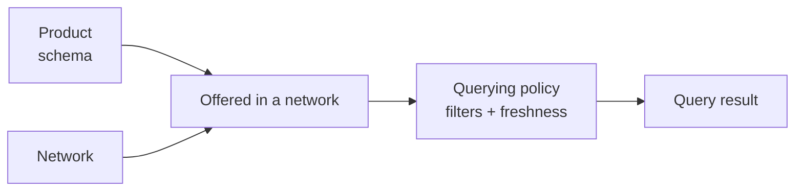

import DashboardQueryingProducts from '/snippets/dashboard/querying-products.mdx';

A **product** is a standardized, named data set that you can **query** (read)
and, for certificate products, **furnish** (write) through the network.
Products give every participant a common schema for a given verification
domain, so data furnished by one participant can be queried by another without
bespoke integration.

## The catalog

Four products are queryable today.

| Product | What it answers | Subject | Query path |
|---|---|---|---|
| [KYC Certificate Snapshot](/api-overview/querying/kyc-certificate-snapshot) | "What identity verification has been furnished for this consumer?" | Consumer | `POST /v1/products/kyc_certificate_snapshot/query` |
| [KYB Certificate Snapshot](/api-overview/querying/kyb-certificate-snapshot) | "What business verification has been furnished for this business?" | Business | `POST /v1/products/kyb_certificate_snapshot/query` |
| [Bank-Specific Bad Actor List](/api-overview/querying/screening-lists) | "Has an institution in this network placed this consumer on its bad actor list?" | Consumer | `POST /v1/products/bank_specific_bad_actor_list/query` |
| [314(b) Cross-Bank Financial Crimes Watch List](/api-overview/querying/screening-lists) | "Has a participating bank reported suspected financial-crimes activity for this consumer?" | Consumer | `POST /v1/products/cross_bank_financial_crimes_watch_list/query` |

They fall into two families:

- **Certificates** are consolidated, multi-part verification results assembled
  from data furnished by network participants. A query that resolves every
  part *issues* a certificate;
  otherwise it returns `204 No Content`.
- **Screening lists** are read-only checks for listings furnished about a
  consumer. They return a listing indicator plus details of the most recent
  listing, never a certificate, and always `200 OK`, with a clean result
  expressed as `"is_listed": false`.

| Behavior | Certificates | Screening lists |
|---|---|---|
| Furnishable via API | Yes — `/furnish` | No — furnishing pipeline only |
| Issues an artifact | Yes — `certificate_id` | No |
| Empty result | `204 No Content` | `200` with `is_listed: false` |
| Non-billable dry run | Yes — `/query/soft` | No |
| Billable query event | Yes | Yes |

## The query / furnish pattern

<CardGroup cols={2}>
  <Card title="Query" icon="magnifying-glass">
    **Read** consolidated data for a subject, drawn from what participants have
    furnished to the networks you query. Requires a
    [consent](/concepts/identity/consent) ID or a direct profile reference.
  </Card>
  <Card title="Furnish" icon="arrow-up-from-bracket">
    **Contribute** verified data for a subject into a network, making it
    available to future queries in that network.
  </Card>
</CardGroup>

```text
POST /v1/products/{product}/query
POST /v1/products/{product}/furnish    (certificate products)
```

Certificate products accept structured JSON furnishing via the API, and bulk
furnishing via [file upload](/api-overview/furnishing/file-upload) or
[SFTP](/api-overview/sftp/overview). The two screening lists are query-only
over the API; their listings are contributed through the
[furnishing pipeline](/api-overview/furnishing/overview).

Two non-billable utilities sit alongside the product queries:

- `POST /v1/products/{kyc,kyb}_certificate_snapshot/query/soft`, the
  [soft check](/api-overview/querying/kyc-certificate-snapshot#soft-check-before-you-query):
  runs the certificate query as a dry run and reports whether a certificate
  would be issued, without returning subject data.
- `POST /v1/products/check`, the
  [coverage check](/api-overview/querying/coverage-check): reports, per
  furnishing institution, which of a product's fields it has furnished for the
  subject.

## How products relate to networks and policies



A product defines *what* data exists: its models, fields, and types. A
[network](/concepts/governance/networks) lists the products it offers to its
members. A [querying policy](/concepts/governance/querying-policies) filters
which furnished records a certificate query may use (e.g. how recent a
verification must be). The same product can produce different results in two
networks that apply different policies.

This is why a certificate query carries `network_ids` and, optionally, a
`policy_id`: the product determines the endpoint and response schema, while the
network and policy scope determines what actually comes back.

Each product's schema is defined as a set of **models**: named groups of typed
fields such as `DocumentCaptureEvent` or `BusinessRiskComplianceEvent`. These
model and field names are the shared vocabulary across the platform: policies
filter on them, the soft check and coverage check report against them, and the
per-product field reference tables document them. When a policy requires
"document captured within the last 29 days," it is expressing a filter over a
product model's fields.

## Querying a product

A product query reads consolidated data for one subject. It needs a
**consent ID** (or a direct profile id) identifying the subject, and a
**network** scope, with an optional policy:

```json
{
  "consent_id": "a3f0b9c7-…",
  "policy_id": "5e7d2a14-…",
  "network_ids": ["9f1c0c2e-…"]
}
```

See [Querying](/api-overview/querying/overview) for the full request anatomy,
`200` vs `204` semantics, the `X-Ref-Id` audit header, and billing notes.

## Furnishing a product

Furnishing contributes one or more records for a subject into a network:

```json
{
  "network_id": "9f1c0c2e-…",
  "records": [
    {
      "first_name": "Jane",
      "last_name": "Doe",
      "date_of_birth": "1990-01-15",
      "social_security_number": "123-45-6789"
    }
  ]
}
```

You must be a furnisher or governor of `network_id`. The network matches each
record to an existing profile on its identifying fields (or creates one) and
stores the furnished data under your organization. See
[Furnishing](/api-overview/furnishing/overview).

## Choosing a product

| If you need to… | Use |
|---|---|
| Reuse a consumer's furnished identity verification at onboarding | [KYC Certificate Snapshot](/api-overview/querying/kyc-certificate-snapshot) |
| Reuse a business's furnished verification, including beneficial owners | [KYB Certificate Snapshot](/api-overview/querying/kyb-certificate-snapshot) |
| Screen a consumer against bad actor listings in your sponsor bank's network | [Bank-Specific Bad Actor List](/api-overview/querying/screening-lists) |
| Screen a consumer for financial-crimes reports shared across banks | [314(b) Cross-Bank Financial Crimes Watch List](/api-overview/querying/screening-lists) |
| Know whether a certificate query would issue before paying for it | [Soft check](/api-overview/querying/kyc-certificate-snapshot#soft-check-before-you-query) |
| See which institutions have furnished which fields for a subject | [Coverage Check](/api-overview/querying/coverage-check) |

In practice these compose: an onboarding flow might run both screening lists,
then the free soft check, then the KYC certificate query only if the soft check
says a certificate would be issued.

<DashboardQueryingProducts />

## Product deep dives

<CardGroup cols={2}>
  <Card title="KYC Certificate Snapshot" icon="id-card" href="/api-overview/querying/kyc-certificate-snapshot">
    Consolidated consumer identity verification: nine sub-products, full field
    reference.
  </Card>
  <Card title="KYB Certificate Snapshot" icon="building" href="/api-overview/querying/kyb-certificate-snapshot">
    Business identity, ownership & control, and risk/compliance in one
    certificate.
  </Card>
  <Card title="Screening Lists" icon="list-check" href="/api-overview/querying/screening-lists">
    The Bank-Specific Bad Actor List and the 314(b) Cross-Bank Financial Crimes
    Watch List.
  </Card>
  <Card title="Coverage Check" icon="list-radio" href="/api-overview/querying/coverage-check">
    Non-billable, per-furnisher view of which fields are on file.
  </Card>
</CardGroup>
