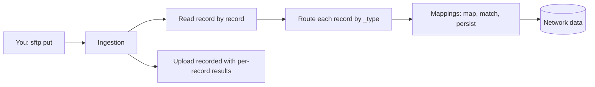

The SOLO Network supports bulk data ingestion via SFTP. Upload
[JSONL files](/api-overview/furnishing/file-upload) to SOLO's SFTP server, and
each file is automatically ingested record by record into the network you name
— through the **same furnishing pipeline** as a
[dashboard upload](/api-overview/furnishing/file-upload#uploading-from-the-dashboard).
SFTP is a transport, not a separate system: a record dropped over SFTP and the
same record uploaded from the dashboard are processed the same way.

Choose SFTP when your data already leaves your systems as files on a schedule.
Core-banking platforms and data warehouses can usually target an SFTP endpoint
with no custom code, which makes this the natural channel for nightly or
monthly batch drops.

## Connecting

Connect to `sftp.solo.one` on port 22. The password is your organization's
**API key** — the same kind of organization API key you use for the REST API
(see [Authentication](/home/authentication)). The username is an email address,
which also selects the environment:

```bash
sftp alice@yourbank.com@sftp.solo.one
```

For the sandbox environment, append `+sandbox` to the local part of the email:

```bash
sftp alice+sandbox@yourbank.com@sftp.solo.one
```

Or using an SFTP library:

<CodeGroup>

```python Python (paramiko)
import paramiko

transport = paramiko.Transport(("sftp.solo.one", 22))
transport.connect(
    username="alice+sandbox@yourbank.com",
    password="<your organization API key>",
)
sftp = paramiko.SFTPClient.from_transport(transport)

network_dir = "network_9f1c0c2e-7a44-4f1e-9d2a-08b6f3a1c5d7"
sftp.put(
    "consumers_aug.jsonl",
    f"/{network_dir}/jsonl_furnish_data/consumers_aug.jsonl",
    confirm=False,
)

sftp.close()
transport.close()
```

```bash SSH config
# ~/.ssh/config
Host solo-sftp
    HostName sftp.solo.one
    User alice+sandbox@yourbank.com
    Port 22
```

</CodeGroup>

### How authentication works

Every connection is checked against the API key, not a stored password:

1. The username is parsed into an email address and an optional environment
   tag: `+sandbox` selects sandbox, and no tag selects production. Usernames
   are case-insensitive, and an unrecognized tag is rejected.
2. The password is validated as an organization API key with SOLO's identity
   provider. Revoked, malformed, or user-owned keys are rejected.
3. The organization that owns the key — not anything in the username — decides
   which SOLO organization the session uploads as. The organization must
   already exist in SOLO.

The username isn't used to authenticate you or to choose your organization; it
only needs to be in email form and to carry the right environment tag.

<Note>
  Because access derives from the **API key**, the key is the credential that
  matters: anyone holding it can upload as your organization and call the REST
  API as your organization. Revoking the key cuts off SFTP access, though a
  recently accepted key can keep signing in for up to a minute while that
  result is cached.
</Note>

<Warning>
  SFTP sessions are **upload-only**. You can `put` files and create
  directories, but listing, downloading, overwriting, and deleting are not
  permitted. Upload each file under a name you haven't used before, and use
  the SOLO dashboard — not the SFTP session — to confirm what was ingested.
</Warning>

## Directory layout

Put each file in the `jsonl_furnish_data/` folder of the network it furnishes
into:

```
network_{network_id}/jsonl_furnish_data/{filename}.jsonl
```

Each SFTP feed's detail page in the dashboard shows the network id to use.
Files placed anywhere else are not ingested.

<Warning>
  Always use the per-network folder. A file placed directly in a top-level
  `jsonl_furnish_data/` folder goes to a network your organization
  **governs**: if it governs several, SOLO picks one for you, and if it governs
  none, ingestion fails.
</Warning>

## What happens on upload

Ingestion starts automatically when an upload completes — there is no polling
window to wait for:



1. **Route.** Each line is read as one record and sent to every active mapping
   in the target network that claims its
   [`_type`](/api-overview/furnishing/file-upload#record-types).
2. **Ingest.** Each mapping maps the record, matches it to a consumer or
   business, and persists its events.
3. **Record.** The outcome — records read, successes, filtered, failures, and
   unmatched record types — is recorded on the upload, which you can review in
   the dashboard.

Key behaviors:

- **Record-level processing** — each line succeeds or fails independently. A
  single invalid line never sinks the rest of the file.
- **Unmatched is not failed** — records whose `_type` no active mapping claims
  are skipped deliberately and reported as unmatched.
- **Processing time budget** — each file has 30 minutes to finish ingesting.
  Ingestion saves progress in batches as it goes, so a file that runs out of
  time, or stops partway for another reason, can be **partially ingested**:
  records processed before that point stay in the network. Check the upload's
  results and re-upload only the records that weren't ingested, in a new file.
  Splitting very large exports into several files keeps each one well within
  the budget.
- **File size** — SOLO doesn't set a size limit on SFTP uploads; the
  processing budget above is the practical bound.
- **Re-sending** — identity records resolve to the existing consumer or
  business on their natural keys, so a re-upload attaches to the same profiles
  instead of duplicating them. Verification events in a re-sent record are
  added again, so don't re-send records that already ingested.

## Relationship to the other channels

SFTP shares everything but the transport with the dashboard upload:

- The same [JSONL format](/api-overview/furnishing/file-upload#file-format)
  and the same routing by `_type`.
- The dashboard shows SFTP drops and dashboard uploads in the same Uploads
  view, with the same per-record result reporting.
- Furnished records are attributed to your organization and recorded for
  [entitlement](/concepts/governance/entitlement), as with a REST furnish.

You can mix channels freely: load history over SFTP and furnish new
onboarding events over REST in real time.

## Environments

Use plus-addressing on the email username to target an environment:

| Environment | Username format | Example |
|---|---|---|
| Production | `email@domain.com` (no tag) | `alice@yourbank.com` |
| Sandbox | `email+sandbox@domain.com` | `alice+sandbox@yourbank.com` |

Sandbox and production are separate environments: nothing uploaded to sandbox
reaches production. Start in sandbox — the
[getting-started guide](/api-overview/sftp/getting-started) walks through a first
upload end to end.

## Who can upload

Your organization must hold the **furnisher** or **governor**
[role](/concepts/governance/network-roles) in the target network. A file
aimed at a network you don't furnish into still uploads, but its ingestion
fails with an access error and no records are written.

<CardGroup cols={2}>
  <Card title="Getting Started" icon="rocket" href="/api-overview/sftp/getting-started">
    Your first upload, end to end.
  </Card>
  <Card title="JSONL Files" icon="file-arrow-up" href="/api-overview/furnishing/file-upload">
    The file format, record types, and results.
  </Card>
  <Card title="Furnishing Policies" icon="shield-check" href="/concepts/governance/furnishing-policies">
    How mappings turn records into network data.
  </Card>
  <Card title="Furnishing Overview" icon="arrow-up-from-bracket" href="/api-overview/furnishing/overview">
    How SFTP relates to the REST furnishing channel.
  </Card>
</CardGroup>
