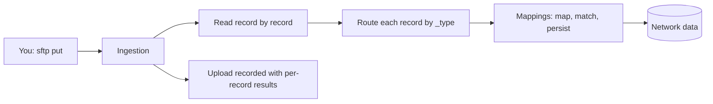

The SOLO Network supports bulk data ingestion via SFTP. Upload
[JSONL files](/api-overview/furnishing/file-upload) to SOLO's SFTP server, and
each file is automatically ingested record by record into the network you name
— through the **same furnishing pipeline** as a
[dashboard upload](/api-overview/furnishing/file-upload#uploading-from-the-dashboard).
SFTP is a transport, not a separate system: a record dropped over SFTP and the
same record uploaded from the dashboard are processed the same way.

Choose SFTP when your data already leaves your systems as files on a schedule.
Core-banking platforms and data warehouses can usually target an SFTP endpoint
with no custom code, which makes this the natural channel for nightly or
monthly batch drops.

## Connecting

Each environment has its own SFTP server, on port 22:

| Environment | SFTP host | Register keys in |
|---|---|---|
| Sandbox | `sftp.api.sandbox.solo.one` | [app.sandbox.solo.one](https://app.sandbox.solo.one) |
| Production | `sftp.api.solo.one` | [app.solo.one](https://app.solo.one) |

You sign in with an **SSH key**, not a password:

1. In the SOLO dashboard, open **Settings → SFTP keys**, give the key a label,
   paste the public half of an SSH key pair, and select **Add key**.
2. The key is listed as **Pending** until the server accepts it — usually
   within a minute — and then as **Synced**. Once your first key syncs, the
   same page shows your SFTP **username**.
3. Connect with that username and the matching private key.

```bash
sftp -i ~/.ssh/solo_sftp <username>@sftp.api.sandbox.solo.one
```

Or using an SFTP library:

<CodeGroup>

```python Python (paramiko)
import paramiko

client = paramiko.SSHClient()
client.load_system_host_keys()  # the server's host key must already be in known_hosts
client.connect(
    "sftp.api.sandbox.solo.one",
    port=22,
    username="<username from Settings → SFTP keys>",
    key_filename="/path/to/solo_sftp",
)
sftp = client.open_sftp()

network_dir = "network_9f1c0c2e-7a44-4f1e-9d2a-08b6f3a1c5d7"
sftp.put(
    "consumers_aug.jsonl",
    f"/{network_dir}/jsonl_furnish_data/consumers_aug.jsonl",
)

sftp.close()
client.close()
```

```bash SSH config
# ~/.ssh/config
Host solo-sftp-sandbox
    HostName sftp.api.sandbox.solo.one
    User <username from Settings → SFTP keys>
    Port 22
    IdentityFile ~/.ssh/solo_sftp
```

</CodeGroup>

### How access works

- **Keys belong to your organization.** Every key registered on the
  **SFTP keys** page signs in as the same SFTP username, and that user can
  reach only your organization's upload area. An organization can register up
  to 10 keys, so give each system that uploads its own key.
- **Accepted keys** are `ssh-ed25519`, or `ssh-rsa` of at least 2048 bits,
  pasted as one OpenSSH public key line (`ssh-ed25519 AAAA… comment`).
- **Removing a key** in the dashboard revokes it on the server shortly after.
  Removing your last key removes your organization's SFTP access until you add
  another.
- **Each environment is separate.** Register keys in each environment's
  dashboard, and use the username that environment's **SFTP keys** page shows.
- **API keys don't work over SFTP.** Organization API keys
  ([Authentication](/home/authentication)) are for the REST API only.

<Note>
  Anyone holding a registered private key can upload as your organization.
  Keep private keys in a secrets manager, and remove a key in the dashboard as
  soon as the system that uses it is retired or compromised.
</Note>

## Directory layout

You land at the root of your organization's upload area. Put each file in the
`jsonl_furnish_data/` folder of the network it furnishes into:

```
network_{network_id}/jsonl_furnish_data/{filename}.jsonl
```

Each SFTP feed's detail page in the dashboard shows the network id to use.
Create the two folders the first time you upload to a network. Files placed
anywhere else are not ingested.

<Warning>
  Always use the per-network folder. A file placed directly in a top-level
  `jsonl_furnish_data/` folder goes to a network your organization
  **governs**: if it governs several, SOLO picks one for you, and if it governs
  none, ingestion fails.
</Warning>

Your session can read as well as write in your organization's upload area, so
you can list and download the files you've uploaded. Use a new filename for
every upload: uploading under a name that already exists replaces that file,
and the new copy is ingested again. Use the SOLO dashboard, not the SFTP
session, to see what was ingested.

## What happens on upload

Ingestion starts automatically when an upload completes — there is no polling
window to wait for:



1. **Route.** Each line is read as one record and sent to every active mapping
   in the target network that claims its
   [`_type`](/api-overview/furnishing/file-upload#record-types).
2. **Ingest.** Each mapping maps the record, matches it to a consumer or
   business, and persists its events.
3. **Record.** The outcome — records read, successes, filtered, failures, and
   unmatched record types — is recorded on the upload, which you can review in
   the dashboard.

Key behaviors:

- **Record-level processing** — each line succeeds or fails independently. A
  single invalid line never sinks the rest of the file.
- **Unmatched is not failed** — records whose `_type` no active mapping claims
  are skipped deliberately and reported as unmatched.
- **Processing time budget** — each file has 30 minutes to finish ingesting.
  Ingestion saves progress in batches as it goes, so a file that runs out of
  time, or stops partway for another reason, can be **partially ingested**:
  records processed before that point stay in the network. Check the upload's
  results and re-upload only the records that weren't ingested, in a new file.
  Splitting very large exports into several files keeps each one well within
  the budget.
- **File size** — SOLO doesn't set a size limit on SFTP uploads; the
  processing budget above is the practical bound.
- **Re-sending** — identity records resolve to the existing consumer or
  business on their natural keys, so a re-upload attaches to the same profiles
  instead of duplicating them. Verification events in a re-sent record are
  added again, so don't re-send records that already ingested.

## Relationship to the other channels

SFTP shares everything but the transport with the dashboard upload:

- The same [JSONL format](/api-overview/furnishing/file-upload#file-format)
  and the same routing by `_type`.
- The dashboard shows SFTP drops and dashboard uploads in the same Uploads
  view, with the same per-record result reporting.
- Furnished records are attributed to your organization and recorded for
  [entitlement](/concepts/governance/entitlement), as with a REST furnish.

You can mix channels freely: load history over SFTP and furnish new
onboarding events over REST in real time.

## Environments

| Environment | SFTP host |
|---|---|
| Sandbox | `sftp.api.sandbox.solo.one` |
| Production | `sftp.api.solo.one` |

Sandbox and production are separate environments, with separate servers, SSH
keys, and data: nothing uploaded to sandbox reaches production. Start in
sandbox — the [getting-started guide](/api-overview/sftp/getting-started) walks
through a first upload end to end.

## Who can upload

Your organization must hold the **furnisher** or **governor**
[role](/concepts/governance/network-roles) in the target network. A file
aimed at a network you don't furnish into still uploads, but its ingestion
fails with an access error and no records are written.

<CardGroup cols={2}>
  <Card title="Getting Started" icon="rocket" href="/api-overview/sftp/getting-started">
    Your first upload, end to end.
  </Card>
  <Card title="JSONL Files" icon="file-arrow-up" href="/api-overview/furnishing/file-upload">
    The file format, record types, and results.
  </Card>
  <Card title="Furnishing Policies" icon="shield-check" href="/concepts/governance/furnishing-policies">
    How mappings turn records into network data.
  </Card>
  <Card title="Furnishing Overview" icon="arrow-up-from-bracket" href="/api-overview/furnishing/overview">
    How SFTP relates to the REST furnishing channel.
  </Card>
</CardGroup>
