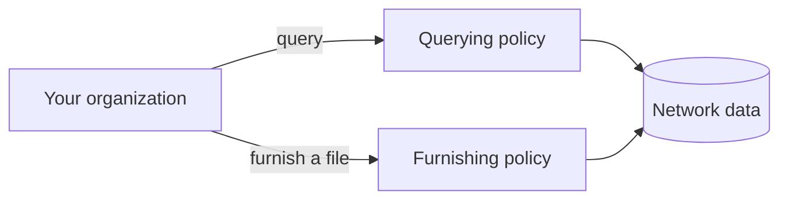

import DashboardGovernanceNetworks from '/snippets/dashboard/governance-networks.mdx';

A **network** is the trust boundary of the SOLO platform. It groups the
participants who have agreed to share data, the **policies** that govern how
that data is read and accepted, and the data that participants furnish.

Everything you do — furnishing, querying, recording consent, searching for
entities — happens *within* a network your organization belongs to.

## What a network represents

A network ties together three things:

- **Participants** — the organizations that hold a membership on the network,
  each with one or more [roles](/concepts/governance/network-roles).
- **Data** — every furnished record is stamped with the network it was
  furnished into, so the network bounds what a query can read.
- **Rules** — the [querying policies](/concepts/governance/querying-policies)
  that decide which furnished verifications qualify on a read, and the
  [furnishing policies](/concepts/governance/furnishing-policies) (mappings)
  that turn furnished files into network data.

A network has a name, an optional description, and a single **governor
entity**: the organization that created it and owns it.

## Networks are independent

Networks are flat. A network has no parent or child networks, and membership
on one network grants nothing on any other. If your organization works across
several networks, it holds a separate membership on each one.

A query can read across several networks at once: list them in `network_ids`
and SOLO reads from all of them, provided your organization holds a membership
on **every** network in the list. A network you aren't a member of fails the
request with `403 PERMISSION_DENIED`; it is never silently dropped.

Every network also carries a `network_type` of `standard`, `sponsor`, or
`partner`. The type is a label that describes the arrangement (for example, a
sponsor bank and the fintechs it works with); all types behave the same way.

<Tip>
If you operate a single product line, you probably need only one network.
Separate networks are useful when you want to keep data, participants, or rules
apart for distinct offerings or partners.
</Tip>

## Network lifecycle

Networks are created in the **SOLO Dashboard**, as part of onboarding your
organization or standing up a new arrangement. A new network needs a **name**
and, optionally, a **description**.

The organization that creates the network is recorded as its governor entity,
and SOLO grants that organization a **governor membership** on the new network
in the same step. A network is therefore never ownerless.

After creation, the governor typically:

1. adds participants with the [roles](/concepts/governance/network-roles) they
   need (furnisher, querier, or additional governors),
2. sets up [furnishing policies](/concepts/governance/furnishing-policies) for
   the data the network accepts, and
3. sets up [querying policies](/concepts/governance/querying-policies) and
   chooses which one applies by default.

## Permissions & roles

Your organization joins a network with one or more **roles**. Roles describe
what you can do, not which records you can see.

| Role | What it allows on the network |
|---|---|
| **Querier** | Query products, run coverage checks, search entities, record consent, and read the network's furnishing policies. |
| **Furnisher** | Everything a querier can do, plus furnish data and create querying policies. |
| **Governor** | Everything a furnisher can do, plus configure any querying policy in the network and administer furnishing policies. The network's governor entity also manages the participant list and the network's settings. |

Any membership — whatever its role — lets your organization query the network.
See [Network Roles](/concepts/governance/network-roles) for the full model and
the per-endpoint breakdown.

<Warning>
  Holding a role on a network does **not** let you read everything other
  members have furnished. What a read returns is still filtered by
  [consent](/concepts/identity/consent) and
  [entitlement](/concepts/governance/entitlement). Roles grant *capabilities*,
  not *visibility*.
</Warning>

## Policy usage within a network

A network applies two kinds of policy:

- A **[querying policy](/concepts/governance/querying-policies)** is a
  network-wide set of read rules. For each data model it configures, it decides
  which furnished verifications qualify when a product is queried. It can cover
  models from any product.
- A **[furnishing policy](/concepts/governance/furnishing-policies)** (called a
  *mapping* in the dashboard) defines how one type of furnished file record is
  mapped, validated, and persisted.

When you query, you scope the request to one or more network ids and,
optionally, a querying policy. When you furnish a file, each record's `_type`
routes it to the network's mappings that claim that type — you never pass a
furnishing policy id yourself.

## Joining a network

There are two ways in:

- **Invitation.** A network's governor adds your organization with the role
  you need.
- **The directory.** A governor can list a network in the dashboard's network
  directory so organizations outside it can find it. A listed network either
  accepts requests to join — as a querier or a furnisher — which wait for the
  governor's approval, or is **open**, in which case your organization can join
  it straight away as a querier. Joining as a furnisher always needs the
  governor's approval.

Membership is managed in the dashboard; there is no REST endpoint for joining
a network. Once you're a member, you can search for entities, record consent,
and query products in the network, and — as a furnisher or governor — furnish
data into it.

See the [quickstart](/home/quickstart/join-a-network) for a walkthrough.

<DashboardGovernanceNetworks />

## Related concepts

<CardGroup cols={2}>
  <Card title="Network Roles" icon="users" href="/concepts/governance/network-roles">
    How organizations participate in a network.
  </Card>
  <Card title="Querying Policies" icon="magnifying-glass" href="/concepts/governance/querying-policies">
    The read rules a network applies when a product is queried.
  </Card>
  <Card title="Furnishing Policies" icon="arrow-up-from-bracket" href="/concepts/governance/furnishing-policies">
    How furnished files are accepted, validated, and routed.
  </Card>
  <Card title="Entitlement" icon="key" href="/concepts/governance/entitlement">
    Why network membership alone doesn't grant data access.
  </Card>
</CardGroup>
