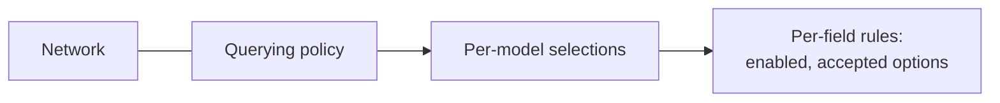

import DashboardGovernanceQueryingPolicies from '/snippets/dashboard/governance-querying-policies.mdx';

A **querying policy** is a network-wide set of read rules. For each data model
it configures, it decides which furnished verifications **qualify** when a
[product](/api-overview/querying/products) is queried in that
[network](/concepts/governance/networks).

A policy belongs to one network and to the organization that created it. It
isn't tied to a product: it names data models (such as `IdentityCorroborationEvent`
or `LivenessCheckEvent`), so one policy can govern every product that reads
those models.



<Note>
Querying policies govern *reads*. The write-side counterpart — how furnished
files are accepted, validated, and routed — is the
[furnishing policy](/concepts/governance/furnishing-policies).
</Note>

## Why querying policies exist

Products define a standard schema — every KYC certificate has the same shape
everywhere. But networks have different standards for what counts as a
verification: one network might accept any document-verification outcome,
while another only accepts a specific result. Querying policies let a network:

- decide which furnished verifications can back a result, field by field,
- keep read rules explicit and auditable — every result names the policy that
  shaped it, and
- change those rules without changing the product or any integration code.

## What a policy contains

| Attribute | Meaning |
|---|---|
| `name` | Display name. Unique per network and owning organization. |
| `network_id` | The network the policy belongs to. |
| `entity_id` | The organization that created and owns the policy. |
| `status` | `draft`, `published`, or `archived`. Saving a configuration through the API publishes the policy. |

Beneath the policy sit **per-model selections**, one for each data model the
policy configures. Each carries:

- **`model_name`** — the data model, as named by
  `GET /v1/graph/models` (for example `LivenessCheckEvent`).
- **`field_selections`** — one rule per field of that model (below).

Each **per-field rule** carries:

- **`field_name`** — the field, e.g. `check_result`.
- **`is_enabled`** — whether the policy constrains this field. A field with
  `is_enabled: false` doesn't restrict which records qualify.
- **`selected_provenance_option_ids`** — the options an enabled field
  accepts. A furnished record qualifies when its value matches **any** of the
  selected options; the list is not a priority order.
- **`boolean_choice`** and **`data_type`** — for a boolean field enabled with
  no options selected, `data_type: "boolean"` with `boolean_choice: "no"`
  accepts `false`; otherwise the field must be `true`.

An enabled field with no options selected uses the field's only option when
it has exactly one, and must have a value when it has none. If the field has
several options you must select at least one, or the save is rejected.

How the policy treats each model:

- **A model the policy configures** is filtered by its enabled fields.
- **A model the policy configures with no field enabled** is not filtered at
  all.
- **A model the policy doesn't mention** keeps the product's own defaults.

## Lifecycle

A policy goes through three steps before it shapes queries by default:

1. **Create** — `POST /v1/networks/policies/querying`. Any furnisher or
   governor of the network can create a policy.
2. **Configure** — `PUT /v1/networks/policies/querying/{policy_id}/configuration`.
   The policy's creator, or a governor of its network, can configure it.
3. **Activate and assign** — in the dashboard, a governor of the network
   activates the policy and assigns it to the network as the **default** for a
   date window. A policy needs at least one configured model before it can be
   activated, and two active policies can't hold overlapping default windows on
   the same network.

Activation and assignment are dashboard-only; there is no REST endpoint for
them.

<Warning>
Saving a configuration **replaces** the selections of every model you send: a
field you leave out of a model accepts nothing once saved. Models you don't
send keep their current selections. Always send each model's complete field
list.
</Warning>

## Creating a policy

### Step 1 — create

`POST /v1/networks/policies/querying` with the network and a name:

```bash
curl -X POST https://api.sandbox.solo.one/v1/networks/policies/querying \
  -H "Authorization: Bearer $SOLO_TOKEN" \
  -H "Content-Type: application/json" \
  -d '{
    "network_id": "9f1c0c2e-7a44-4f1e-9d2a-08b6f3a1c5d7",
    "name": "Coastal KYC — standard read"
  }'
```

```json
{
  "id": "5e7d2a14-3b9c-4f0e-8a61-2c7d9e0f1b34",
  "network_id": "9f1c0c2e-7a44-4f1e-9d2a-08b6f3a1c5d7",
  "entity_id": "7c2d91e4-5a6b-4c8d-9e0f-1a2b3c4d5e6f",
  "name": "Coastal KYC — standard read"
}
```

The new policy has no selections, isn't active, and isn't assigned to the
network, so it doesn't affect any query until you configure it and either name
it explicitly or make it the network's default.

### Step 2 — configure

`PUT /v1/networks/policies/querying/{policy_id}/configuration` with the
per-model, per-field selections:

```bash
curl -X PUT https://api.sandbox.solo.one/v1/networks/policies/querying/5e7d2a14-3b9c-4f0e-8a61-2c7d9e0f1b34/configuration \
  -H "Authorization: Bearer $SOLO_TOKEN" \
  -H "Content-Type: application/json" \
  -d '{
    "model_selections": [
      {
        "model_name": "IdentityCorroborationEvent",
        "field_selections": [
          {
            "field_name": "is_ssn_match",
            "is_enabled": true,
            "data_type": "boolean",
            "selected_provenance_option_ids": []
          },
          {
            "field_name": "kyc_decision",
            "is_enabled": true,
            "selected_provenance_option_ids": ["11aa22bb-3c4d-4e5f-8a9b-0c1d2e3f4a5b"]
          }
        ]
      },
      {
        "model_name": "LivenessCheckEvent",
        "field_selections": [
          {
            "field_name": "check_result",
            "is_enabled": true,
            "selected_provenance_option_ids": ["33cc44dd-5e6f-4a7b-9c8d-1e2f3a4b5c6d"]
          }
        ]
      }
    ]
  }'
```

```json
{
  "id": "5e7d2a14-3b9c-4f0e-8a61-2c7d9e0f1b34",
  "name": "Coastal KYC — standard read",
  "status": "published"
}
```

You can include a `"name"` in the configuration body to rename the policy in
the same call. Each field's options and their ids are listed in the
dashboard's policy editor, which builds the same configuration.

## How a query selects a policy

When you [query a product](/api-overview/querying/overview), the request names
the networks to read and, optionally, a policy:

```bash
curl -X POST https://api.sandbox.solo.one/v1/products/kyc_certificate_snapshot/query \
  -H "Authorization: Bearer $SOLO_TOKEN" \
  -H "Content-Type: application/json" \
  -d '{
    "consent_id": "a3f0b9c7-2d14-4e8a-9b6f-1c0e7d5a3f92",
    "network_ids": ["9f1c0c2e-7a44-4f1e-9d2a-08b6f3a1c5d7"],
    "policy_id": "5e7d2a14-3b9c-4f0e-8a61-2c7d9e0f1b34"
  }'
```

- **`network_ids`** (required) — one or more networks to read across. Your
  organization needs a membership on each.
- **`policy_id`** (optional) — the policy to apply. One policy is applied
  across every network in `network_ids`.

**With `policy_id`**, that policy is applied whether or not it is active or
assigned. A `policy_id` that doesn't exist or that you can't access fails the
query with `404 RESOURCE_NOT_FOUND`. When you name a policy explicitly, a
certificate is issued only if every data field the policy selects is
populated; otherwise the query returns `204 No Content`.

**Without `policy_id`**, SOLO uses the active policy assigned as the default
for the **first** network in `network_ids` on today's date, and applies it
across all the networks you listed. If no policy holds that assignment, the
product's own defaults apply.

The result's `meta` records the policy that shaped it, so every result is
auditable:

```json
{
  "result": {
    "meta": {
      "network_id": "9f1c0c2e-7a44-4f1e-9d2a-08b6f3a1c5d7",
      "policy_id": "5e7d2a14-3b9c-4f0e-8a61-2c7d9e0f1b34"
    }
  }
}
```

<Tip>
If your network has one default policy assigned, queriers can omit
`policy_id` and always get the network's rules. Reserve an explicit
`policy_id` for networks that run several read profiles side by side.
</Tip>

### Querying across multiple networks

`network_ids` accepts more than one network, and the one policy is applied
across all of them. When several furnished records qualify for a model, SOLO
uses the oldest one found in any of the listed networks. Two things to keep in
mind:

- **Authorization is per network.** A network in the list that your
  organization isn't a member of fails the query with `403 PERMISSION_DENIED`
  rather than being silently dropped.
- **The policy filters; it doesn't grant.** Adding networks widens where SOLO
  looks, but [entitlement](/concepts/governance/entitlement) still decides
  which records you can read.


## The policy decides what qualifies, not who can read it

A querying policy decides which furnished verifications can back a result, for
everyone who queries with it. What *you* get back is further narrowed by
[entitlement](/concepts/governance/entitlement):

| Question | Answered by |
|---|---|
| *Which furnished verifications count, in this network?* | **Querying policy** |
| *Which of those records and fields may* ***I*** *read?* | **Entitlement** |

Enabling a field in the policy never exposes data to someone who isn't
entitled to it.

## Errors you may encounter

Errors use the standard envelope (see [Errors](/home/errors)):

```json
{ "detail": "…", "error_code": "RESOURCE_NOT_FOUND" }
```

| Situation | Result |
|---|---|
| A query names a `policy_id` that doesn't exist or that you can't access | `404` `RESOURCE_NOT_FOUND` |
| A query lists a network your organization isn't a member of | `403` `PERMISSION_DENIED` |
| Malformed body (missing field, bad UUID) | `422`, short shape with `detail` only |
| A configuration names an option that doesn't belong to its field, or leaves a several-option field with none selected | Rejected; nothing is saved |
| Creating a policy with a name the same organization already uses in the network | Rejected |

<DashboardGovernanceQueryingPolicies />

## Related concepts

<CardGroup cols={2}>
  <Card title="Furnishing Policies" icon="arrow-up-from-bracket" href="/concepts/governance/furnishing-policies">
    The write-side counterpart: how data gets into the network.
  </Card>
  <Card title="Entitlement" icon="key" href="/concepts/governance/entitlement">
    The per-participant layer that decides what you can read.
  </Card>
  <Card title="Querying" icon="magnifying-glass" href="/api-overview/querying/overview">
    How policies plug into a product query.
  </Card>
  <Card title="Networks" icon="sitemap" href="/concepts/governance/networks">
    The boundary policies are scoped to.
  </Card>
</CardGroup>
