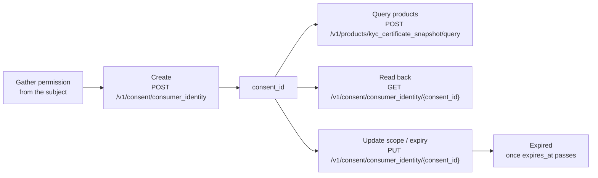

import DashboardIdentityConsent from '/snippets/dashboard/identity-consent.mdx';


**Consent** is your record that you have permission to query a specific consumer
or business. Querying personal and business data carries a legal obligation to
have a permissible purpose — consent is how the network captures, and can later
prove, that you had one.

A consent record is two things at once:

- **A key.** You create it once per subject per network, receive a
  `consent_id`, and pass that `consent_id` on product queries for the subject.
- **An audit artifact.** The record captures *who* consented, *as identified by
  which details*, and *when* — so that queries run with it can be traced back to
  a lawful basis.

That dual nature drives the API's design, including its strictest rule: the
identity on a consent record can never be edited.

## Lifecycle

A consumer consent record has one endpoint for each step you control:



You gather the subject's permission **outside** the API — in your onboarding
flow, your terms, your call script — then record it. From there the
`consent_id` can be used on queries until the consent expires.

There is no revocation or delete endpoint. To end a consent early, set its
`expires_at` to the current time with
`PUT /v1/consent/consumer_identity/{consent_id}`; queries using it are refused
from then on.

## What a consent record contains

All three consumer endpoints return the same shape:

| Field | Type | Notes |
|---|---|---|
| `consent_id` | string | The token you pass on product queries |
| `model_access_grants` | array | Grants attached to this consent — see [below](#model-access-grants) |
| `created_at` | string | When the record was created |
| `scope` | string | Free-form scope label; empty until you set one |
| `expires_at` | string \| null | When the consent lapses; `null` means no expiry |
| `consented_fields` | string \| null | Free-form description of what the subject consented to |
| `events` | string | Event history for the record |

## Creating consent

`POST /v1/consent/consumer_identity` records consent server-to-server. You supply the
subject's identity and attest that you gathered their permission beforehand.

| Body field | Required | Notes |
|---|---|---|
| `network_id` | Yes | The [network](/concepts/governance/networks) the consent belongs to. Your organization must be a member. |
| `did_gather_consent_from_consumer_prior` | Yes | Must be `true` — see warning below |
| `consumer_consent_event_identity` | Yes | `first_name`, `last_name`, `date_of_birth`, `personal_email`, `phone_number`, `social_security_number` — all required |
| `consumer_identity_id` | No | Link to an existing consumer profile found via [entity search](/concepts/identity/entities) |

```bash
curl -X POST https://api.sandbox.solo.one/v1/consent/consumer_identity \
  -H "Authorization: Bearer $SOLO_TOKEN" \
  -H "Content-Type: application/json" \
  -d '{
    "network_id": "9f1c0c2e-7a44-4f1e-9d2a-08b6f3a1c5d7",
    "did_gather_consent_from_consumer_prior": true,
    "consumer_consent_event_identity": {
      "first_name": "Jane",
      "last_name": "Doe",
      "date_of_birth": "1990-01-15",
      "personal_email": "jane@example.com",
      "phone_number": "+14155550100",
      "social_security_number": "123-45-6789"
    }
  }'
```

A `200 OK` returns the full record, including the default grant created with the
consent:

```json
{
  "consent_id": "a3f0b9c7-2d14-4e8a-9b6f-1c0e7d5a3f92",
  "model_access_grants": [
    {
      "furnishing_entity_id": null,
      "models": ["fraud_verification_event"],
      "effective_from": "2026-06-09",
      "effective_to": null
    }
  ],
  "created_at": "2026-06-09T22:14:03.512000+00:00",
  "events": "",
  "scope": "",
  "expires_at": null,
  "consented_fields": null
}
```

The consent record stores the subject's name, date of birth, and SSN, the email
address you supplied as the identifier of who consented, and when the consent
was recorded. The phone number is required by the request but is not stored.

<Warning>
  `did_gather_consent_from_consumer_prior: true` is an **attestation** that you
  obtained the consumer's permission before making this call. Sending `false`
  is rejected with `400 VALIDATION_ERROR` — the network will not create a
  consent record that asserts no consent was gathered.
</Warning>

### Linking identity: `consumer_identity_id` vs. the identity payload

How the consent attaches to an [entity](/concepts/identity/entities) depends on
whether you pass `consumer_identity_id`:

- **With `consumer_identity_id`** — the consent links to that existing consumer
  profile. Use this after a successful
  `GET /v1/entities/consumer_identity/search`, so the subject's history stays
  on one profile.
- **Without `consumer_identity_id`** — a new consumer profile is created from
  the identity payload and linked to the consent, even if a profile for the
  same person already exists. Search first to avoid creating duplicates.

Either way, the identity details you submitted are stamped onto the consent
record itself as the audit trail of who consented.

## Using a consent ID

Pass the `consent_id` in the body of a product query, together with the
networks to read. The network resolves the consent to the subject — you don't
repeat their identifying details on every call.

```bash
curl -X POST https://api.sandbox.solo.one/v1/products/kyc_certificate_snapshot/query \
  -H "Authorization: Bearer $SOLO_TOKEN" \
  -H "Content-Type: application/json" \
  -d '{
    "consent_id": "a3f0b9c7-2d14-4e8a-9b6f-1c0e7d5a3f92",
    "network_ids": ["9f1c0c2e-7a44-4f1e-9d2a-08b6f3a1c5d7"]
  }'
```

Three rules apply:

- **The consent is bound to its network.** A consent is honoured only when the
  network it was created in is one of the query's `network_ids`; otherwise the
  query returns `404 RESOURCE_NOT_FOUND`.
- **Expired consent is refused.** Once `expires_at` has passed, a query using
  the consent returns `403 PERMISSION_DENIED`.
- **One way to name the subject.** Instead of a `consent_id`, a query can name
  the subject directly with `consumer_identity_id` (or `business_identity_id`
  for business products). The subject must be visible to you in one of the
  requested networks, or the query returns `404`. Supplying both a
  `consent_id` and an identity id returns `400 VALIDATION_ERROR`.

See [Querying your first product](/home/quickstart/query-a-product) for the
end-to-end walkthrough.

## Reading consent back

`GET /v1/consent/consumer_identity/{consent_id}` returns the current state of a consent
record. The `network_id` query parameter is **required** — the lookup is scoped
to that network:

```bash
curl -G https://api.sandbox.solo.one/v1/consent/consumer_identity/a3f0b9c7-2d14-4e8a-9b6f-1c0e7d5a3f92 \
  -H "Authorization: Bearer $SOLO_TOKEN" \
  --data-urlencode "network_id=9f1c0c2e-7a44-4f1e-9d2a-08b6f3a1c5d7"
```

The response is the same shape as create. If the `consent_id` doesn't exist
**or** belongs to a different network, you get a `404`:

```json
{
  "detail": "Consent record not found",
  "error_code": "RESOURCE_NOT_FOUND"
}
```

<Note>
  A consent record belongs to one network. The same subject needs a separate
  consent in each network you query them through, and a `consent_id` created
  in one network is invisible — `404`, not `403` — from another.
</Note>

## Updating consent

`PUT /v1/consent/consumer_identity/{consent_id}` changes the **mutable attributes** of a
consent record: its scope, its expiry, and the description of consented fields.

| Body field | Required | Notes |
|---|---|---|
| `network_id` | Yes | Network scope — same rule as read |
| `scope` | At least one of these three | New scope label |
| `expires_at` | | New expiry timestamp (ISO 8601). Set it to now to end the consent. |
| `consented_fields` | | New consented-fields description |

```bash
curl -X PUT https://api.sandbox.solo.one/v1/consent/consumer_identity/a3f0b9c7-2d14-4e8a-9b6f-1c0e7d5a3f92 \
  -H "Authorization: Bearer $SOLO_TOKEN" \
  -H "Content-Type: application/json" \
  -d '{
    "network_id": "9f1c0c2e-7a44-4f1e-9d2a-08b6f3a1c5d7",
    "scope": "kyc",
    "expires_at": "2027-06-09T00:00:00Z"
  }'
```

The response is the **post-update** record:

```json
{
  "consent_id": "a3f0b9c7-2d14-4e8a-9b6f-1c0e7d5a3f92",
  "model_access_grants": [
    {
      "furnishing_entity_id": null,
      "models": ["fraud_verification_event"],
      "effective_from": "2026-06-09",
      "effective_to": null
    }
  ],
  "created_at": "2026-06-09T22:14:03.512000+00:00",
  "events": "",
  "scope": "kyc",
  "expires_at": "2027-06-09T00:00:00+00:00",
  "consented_fields": null
}
```

Omitting all three updatable fields is a `400`:

```json
{
  "detail": "At least one of scope, expires_at, or consented_fields must be provided",
  "error_code": "VALIDATION_ERROR"
}
```

### Identity is immutable — by design

The update endpoint accepts **only** `scope`, `expires_at`, and
`consented_fields`. The identity recorded on a consent can never change.

<Warning>
  A consent record is an audit artifact of **who consented and when**. If the
  identity could be edited after the fact, the record could no longer prove
  which person's permission authorized your past queries. To consent with
  different identity data — a legal name change, a corrected SSN — create a
  **new** consent record and use its `consent_id` going forward.
</Warning>

## Model access grants

Each consumer consent record carries its grants in `model_access_grants`. A
grant states which **data models** the consent covers, for which furnisher,
over which dates:

| Grant field | Type | Meaning |
|---|---|---|
| `furnishing_entity_id` | string \| null | The furnisher whose records the grant opens to you. `null` means the grant isn't tied to a furnisher. |
| `models` | array of strings | The data models covered, e.g. `fraud_verification_event`. A grant covers every data field of each model it lists. |
| `effective_from` | string \| null | Date the grant becomes active. |
| `effective_to` | string \| null | Date the grant lapses; `null` means open-ended. |

Every consumer consent created through the API carries one grant: the
**default grant**, covering `fraud_verification_event`, not tied to a
furnisher, effective from the day the consent was created with no end date. A
grant stops applying when its consent expires.

<Note>
  Grants describe what this **consent** covers. They work alongside
  [entitlement](/concepts/governance/entitlement), which explains exactly how
  grants, your own furnished data, and the
  [querying policy](/concepts/governance/querying-policies) combine to decide
  what a query returns.
</Note>

## Failure modes

| Status | `error_code` | When |
|---|---|---|
| `400` | `VALIDATION_ERROR` | `did_gather_consent_from_consumer_prior` is `false` on create |
| `400` | `VALIDATION_ERROR` | Update with none of `scope`, `expires_at`, `consented_fields` |
| `400` | `VALIDATION_ERROR` | A query supplies both a `consent_id` and an identity id |
| `403` | `PERMISSION_DENIED` | Your organization isn't a member of `network_id` |
| `403` | `PERMISSION_DENIED` | A query uses a consent whose `expires_at` has passed |
| `404` | `RESOURCE_NOT_FOUND` | Unknown `consent_id`, or a consent from a network the request doesn't name |
| `422` | — | Request shape errors: missing required fields, wrong types |

Error responses follow the standard envelope — see [Errors](/home/errors):

```json
{
  "detail": "Consent cannot be created without prior consumer consent gathering",
  "error_code": "VALIDATION_ERROR"
}
```

## Business consent

`POST /v1/consent/business_identity` records consent to query a business:

| Body field | Required | Notes |
|---|---|---|
| `network_id` | Yes | The network the consent belongs to. Your organization must be a member. |
| `did_gather_consent_from_business_prior` | Yes | Must be `true`; `false` is rejected with `400 VALIDATION_ERROR` |
| `business_consent_event_identity` | Yes | `business_legal_name`, `business_jurisdiction_of_formation`, and `business_registration_identifier_from_jurisdiction_of_formation` are required; `business_dba_name`, `business_tax_identifier_type`, `business_tax_identifier_value`, and `business_website_url` are optional. All are strings. |
| `business_identity_id` | No | Link to an existing business profile found via [entity search](/concepts/identity/entities) |

```bash
curl -X POST https://api.sandbox.solo.one/v1/consent/business_identity \
  -H "Authorization: Bearer $SOLO_TOKEN" \
  -H "Content-Type: application/json" \
  -d '{
    "network_id": "9f1c0c2e-7a44-4f1e-9d2a-08b6f3a1c5d7",
    "did_gather_consent_from_business_prior": true,
    "business_consent_event_identity": {
      "business_legal_name": "Acme Corp",
      "business_jurisdiction_of_formation": "DE",
      "business_registration_identifier_from_jurisdiction_of_formation": "1234567",
      "business_tax_identifier_type": "EIN",
      "business_tax_identifier_value": "12-3456789"
    }
  }'
```

The response contains `consent_id`, `consented_fields`, `created_at`, `events`,
and `scope`. Use the `consent_id` on business product queries exactly as you
would a consumer one; the same network-binding rule applies.

When the tax identifier type is `EIN` (or omitted), the tax identifier value is
recorded as the business's federal EIN. The consent stores the business's
legal name and federal EIN. Without `business_identity_id`, a new business
profile is created from the identity details. Business consents carry no model
access grant.

<Note>
  Business consent currently supports **create only**. There is no read-back
  or update endpoint for business consents, so a business consent can't be
  read back, updated, or given an expiry through the API. To change it, create
  a new record and switch to its `consent_id`.
</Note>

## How consent relates to entitlement

Consent and [entitlement](/concepts/governance/entitlement) are complementary
gates, and a query needs both:

| | Consent | Entitlement |
|---|---|---|
| Question it answers | *May I query this subject at all?* | *Which records and fields come back?* |
| How you get it | Record permission, get a `consent_id` | Furnish data, or hold a grant covering another furnisher's data |
| Scope | One subject, in one network | Per record, per model |
| Carried on the query | `consent_id` in the request body | Applied automatically by the network |
| Can it change? | Mutable scope and expiry; immutable identity | Grows as you furnish |

Consent without entitlement yields a permitted query with little or no data.

## Common questions

<AccordionGroup>
  <Accordion title="Should I reuse a consent_id across queries?">
    Yes. Create one consent per subject per network and reuse its `consent_id`
    on every product query for that subject while the consent is valid. You do
    not need a new consent record for each query.
  </Accordion>
  <Accordion title="Why does GET return 404 for a consent I just created?">
    The read is scoped by the `network_id` query parameter. The most common
    cause is passing a different `network_id` than the one the consent was
    created under — the record exists, but it isn't visible from that network,
    so the API reports `404 RESOURCE_NOT_FOUND` rather than confirming it
    exists elsewhere. The same applies to a query whose `network_ids` doesn't
    include the consent's network.
  </Accordion>
  <Accordion title="How do I revoke a consent?">
    Set its `expires_at` to the current time with
    `PUT /v1/consent/consumer_identity/{consent_id}`. There is no separate
    revoke or delete endpoint; the record stays as part of the audit trail.
  </Accordion>
  <Accordion title="When do I update versus create a new consent?">
    **Update** when the subject's permission itself changed shape — a broader
    or narrower scope, a new expiry date, a revised description of consented
    fields. **Create new** when anything about the subject's identity needs to
    differ: identity fields are immutable, so a corrected SSN or a legal name
    change requires a fresh record and a switch to its `consent_id`.
  </Accordion>
  <Accordion title="Does furnishing require consent?">
    The `consent_id` requirement documented here applies to **queries** —
    reading data back out of the network. See
    [Furnishing](/api-overview/furnishing/overview) for the obligations that apply when
    contributing data.
  </Accordion>
</AccordionGroup>


<DashboardIdentityConsent />

## Related concepts

<CardGroup cols={2}>
  <Card title="Entities" icon="users" href="/concepts/identity/entities">
    The subjects consent records are about, and how to find them.
  </Card>
  <Card title="Querying" icon="magnifying-glass" href="/api-overview/querying/overview">
    How consent plugs into a product query.
  </Card>
  <Card title="Entitlement" icon="key" href="/concepts/governance/entitlement">
    What determines which records and fields a query returns.
  </Card>
  <Card title="Errors" icon="triangle-exclamation" href="/home/errors">
    The error envelope and status codes used across the API.
  </Card>
</CardGroup>
