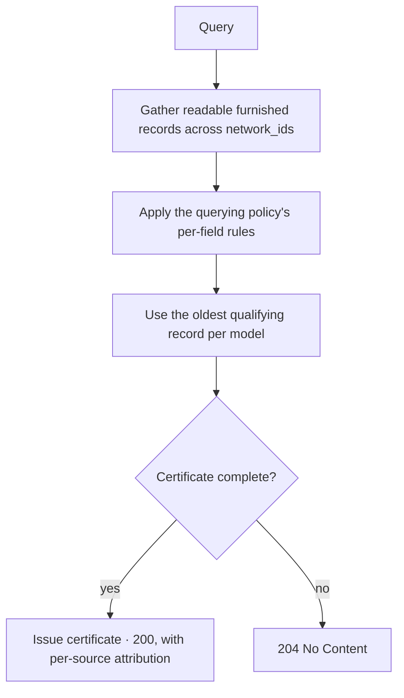

Provenance is what separates a SOLO network from a black box. Banks do not want
to trust SOLO; they want to trust the **institution that did the verification**,
and to see the evidence. So every reusable [trust asset](/concepts/trust/trust-assets)
carries its lineage: who contributed it, who attested to it, when, by what
method, and on what evidence.

> SOLO does not ask participants to trust unattributed data. It preserves the
> lineage of every reusable verification.

## The lineage every certificate carries

When a [product query](/api-overview/querying/products) consolidates verifications
into a certificate, each populated sub-product is self-describing:

```json
{
  "business_identity_verification": {
    "furnishing_entity_id": "e1d2c3b4-5a69-4788-9a0b-1c2d3e4f5a6b",
    "attestation_event_id": "f0a1b2c3-d4e5-4f60-8a1b-2c3d4e5f6a7b",
    "assertions": {
      "business_identity_verification_assertion": true,
      "business_identity_verification_performed_timestamp": "2026-05-02T00:00:00Z"
    },
    "data": {
      "business_formation_document_artifact": "articles_of_organization.pdf",
      "business_identity_verification_sources": ["state_registry"],
      "business_tax_id_validation_result": "match"
    }
  }
}
```

| Lineage element | Field | What it tells the reader |
|---|---|---|
| **Contributor** | `furnishing_entity_id` | Which participant furnished this verification |
| **Attestation** | `attestation_event_id` | The attestation record linking that participant to the asserted facts |
| **Assertion and time** | `assertions.*` and its `…_timestamp` | What was asserted, and when the verification was performed |
| **Method and sources** | `data` fields such as `…_sources`, `…_method`, `…_result` | How it was verified, and against what |
| **Evidence** | artifact and upload fields (e.g. `…_artifact`) | The document behind the assertion |

Each query result also records, in `meta`, the network and the
[querying policy](/concepts/governance/querying-policies) that shaped it, and
product query responses carry an `X-Ref-Id` header identifying the query event.

The [coverage check](/api-overview/querying/coverage-check) goes a step further
and returns a human-readable `furnishing_entity_name` alongside the
`furnishing_entity_id`, so you can see which participants could satisfy a
product for a subject before you query.

## One subject, many furnishers

An entity profile is a **shared subject**, not a record any one participant
owns. Several participants can furnish about the same consumer or business —
one contributes identity verification, another fraud signals, a third business
registration. All of it attaches to the same profile, and each contribution
keeps its own attribution.

Two consequences follow:

1. **You don't own the whole profile.** Your furnished records sit alongside
   others'. Furnishing never overwrites another participant's records.
2. **What you can read is governed, not automatic.** Sharing a subject with
   another furnisher does not mean you see their data — see
   [Entitlement](/concepts/governance/entitlement).

## How the network picks which verification to use

When several furnished records could answer for the same model, the query does
not guess:

1. The [querying policy](/concepts/governance/querying-policies) filters which
   furnished records qualify, field by field.
2. Of the qualifying records you're [entitled](/concepts/governance/entitlement)
   to read, SOLO uses the **oldest** one found in any of the networks you
   queried.



You can also narrow which contributors are considered: pass
`furnishing_entity_ids` on a query to use only those participants' records.

## Why provenance is exposed on purpose

For most software, exposing internals is a mistake. For SOLO it is the product:
participants build on each other's work *because* they can see who did it, how,
and when. Provenance turns "trust SOLO" into "trust the network, transparently."

<Note>
  Provenance here means the lineage that exists today — `furnishing_entity_id`,
  `attestation_event_id`, assertion timestamps, source, method, and evidence
  fields, and the network and policy recorded in each result's `meta`.
  It does not include reuse counters, dispute counts, or contributor reputation
  scores, which are not part of the current platform.
</Note>

## Related

<CardGroup cols={2}>
  <Card title="Trust assets" icon="award" href="/concepts/trust/trust-assets">
    The reusable unit provenance describes.
  </Card>
  <Card title="Entitlement" icon="key" href="/concepts/governance/entitlement">
    Why you can read a given record about a subject.
  </Card>
  <Card title="Querying policies" icon="scale-balanced" href="/concepts/governance/querying-policies">
    The rules that decide which verifications qualify.
  </Card>
  <Card title="Coverage check" icon="list-radio" href="/api-overview/querying/coverage-check">
    See which furnishers can satisfy a product before you query.
  </Card>
</CardGroup>
