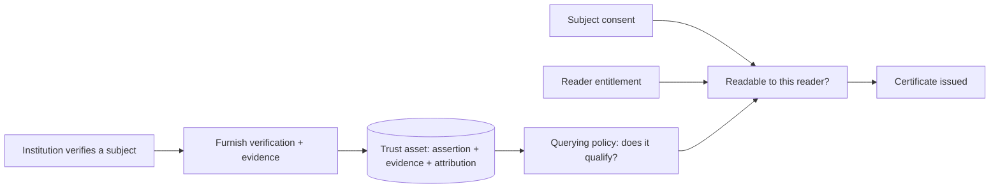

A **trust asset** is the reusable unit of a SOLO network: a verification that
one institution completed, backed by evidence, attributed to its source, and
governed by permission — so that a participant authorized to read it can build
on it instead of repeating the work.

"Trust asset" is a lens, not a new API object. It names what already exists in
the platform when you put the pieces together: a furnished
[verification](/api-overview/furnishing/overview) event, its supporting evidence,
the [attestation](/concepts/trust/provenance) that records who stands behind it,
and the [consent](/concepts/identity/consent) and
[entitlement](/concepts/governance/entitlement) that decide who may read it. A
[product query](/api-overview/querying/products) assembles trust assets into a
certificate.

## What makes a verification a *trust asset*

A raw data point is not reusable on its own. Another bank cannot act on a value
with no idea who produced it, how, or when. A trust asset carries the context
that makes reuse safe:

| Dimension | The trust question | Where it lives in the API |
|---|---|---|
| **Subject** | Who is this about? | The [entity](/concepts/identity/entities) (consumer or business) |
| **Assertion** | What was attested, and when? | The sub-product's `assertions` block (e.g. `business_identity_verification_assertion`, with its `…_timestamp`) |
| **Evidence** | Why should anyone believe it? | The sub-product's `data` block and artifact fields (e.g. `business_formation_document_artifact`) |
| **Attribution** | Who verified it? | `furnishing_entity_id` and `attestation_event_id` on each populated sub-product |
| **Permission** | May this subject be queried? | The subject's [consent](/concepts/identity/consent) |
| **Visibility** | May *this* reader see it? | [Entitlement](/concepts/governance/entitlement) |
| **Eligibility** | Does it count under this network's rules? | The [querying policy](/concepts/governance/querying-policies)'s per-field rules |
| **Consolidation** | How is it delivered? | A [certificate](/api-overview/querying/products), identified by `certificate_id` |

A data aggregator returns the first row of that table. SOLO returns all of it.

## A trust asset, concretely

Here is one populated sub-product from a [KYB certificate](/api-overview/querying/kyb-certificate-snapshot)
query result — a single trust asset:

```json
{
  "business_identity_verification": {
    "furnishing_entity_id": "e1d2c3b4-5a69-4788-9a0b-1c2d3e4f5a6b",
    "attestation_event_id": "f0a1b2c3-d4e5-4f60-8a1b-2c3d4e5f6a7b",
    "assertions": {
      "business_identity_verification_assertion": true,
      "business_identity_verification_performed_timestamp": "2026-05-02T00:00:00Z"
    },
    "data": {
      "business_formation_document_artifact": "articles_of_organization.pdf",
      "business_jurisdiction_of_formation": "DE",
      "business_registration_identifier": "7423918",
      "business_registration_status": "active",
      "business_identity_verification_sources": ["state_registry"],
      "business_tax_id_validation_result": "match"
    }
  }
}
```

Read it as a trust asset:

- **Subject** — the business the certificate was issued for
  (`business_identity_id` on the enclosing response).
- **Assertion** — business identity *was* verified, on `2026-05-02`.
- **Evidence** — backed by an articles-of-organization artifact, a state
  registry source, and a tax-ID match.
- **Attribution** — furnished and attested by the participant identified by
  `furnishing_entity_id` / `attestation_event_id`.
- **Reuse** — returned to you only because you named the subject with a valid
  consent, you are entitled to read this record, and it qualified under the
  network's querying policy.

A participant entitled to read this record doesn't need to re-pull the registry
or re-collect the formation document: it queries the certificate and builds on
this asset, with the contributor's attribution attached.

## How trust assets are created and reused



1. **Create.** An institution [furnishes](/api-overview/furnishing/overview) the
   verification it performed. The furnished events, their evidence, and the
   institution's attestation become a trust asset attributed to that
   contributor.
2. **Govern.** [Consent](/concepts/identity/consent) decides whether the
   subject can be queried; the
   [querying policy](/concepts/governance/querying-policies) decides whether
   the asset qualifies; [entitlement](/concepts/governance/entitlement) decides
   whether a given reader may see it.
3. **Reuse.** A [product query](/api-overview/querying/products) consolidates
   the qualifying, readable trust assets into a
   [certificate](/api-overview/querying/kyc-certificate-snapshot). If they
   can't complete the certificate, the query returns `204` rather than a
   partial or unattributed answer.

## The three layers

Trust assets sit in the middle of how the platform is organized:

| Layer | What it is | Pages |
|---|---|---|
| **Trust graph** | The subjects and the verifications attached to them | [Consumer graph](/concepts/trust/consumer-graph), [Business graph](/concepts/trust/business-graph) |
| **Trust assets** | Attested, evidenced verifications that can be reused | This page, [Provenance](/concepts/trust/provenance) |
| **Trust products** | The outcomes a query delivers | [Products](/api-overview/querying/products), [KYC](/api-overview/querying/kyc-certificate-snapshot), [KYB](/api-overview/querying/kyb-certificate-snapshot) |

<Note>
  Trust assets describe data that **exists today** — furnished verification
  events, their attestations, and the certificates that consolidate them. SOLO
  does not expose a standalone trust-asset object, reuse counters, or
  verification "tiers"; the reusable asset is the furnished, attested
  verification itself, surfaced through certificate queries.
</Note>

## Related

<CardGroup cols={2}>
  <Card title="Provenance" icon="fingerprint" href="/concepts/trust/provenance">
    The lineage every trust asset carries.
  </Card>
  <Card title="Business graph" icon="building" href="/concepts/trust/business-graph">
    The trust assets that can exist for a business.
  </Card>
  <Card title="Consumer graph" icon="user" href="/concepts/trust/consumer-graph">
    The trust assets that can exist for a consumer.
  </Card>
  <Card title="Products" icon="box" href="/api-overview/querying/products">
    How trust assets are consolidated and delivered.
  </Card>
</CardGroup>
