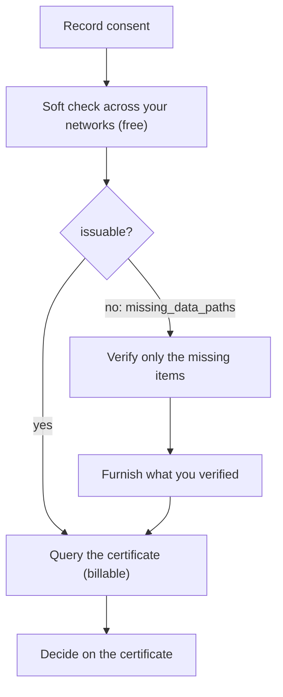

As a fintech you operate inside one or more sponsor banks' networks. For each
applicant you record consent, ask whether your networks can already certify
them, verify only what's missing, and query one certificate built from records
across all of those networks. Your sponsor bank's side is
[Golden path: sponsor banks](/home/golden-paths/sponsor-banks); how the two fit
together is in the [overview](/home/golden-paths/overview).



The examples follow one applicant through a fintech that runs programs with
two sponsor banks. The applicant is applying through Bank One's program
(network `9f1c0c2e-…`), and the fintech also operates in Bank Two's network
(`2c7e9b14-…`).

## Prerequisites

<Note>
  - Membership with the furnisher role in each sponsor bank's network you
    operate in. See [Getting access](/home/quickstart#getting-access).
  - A sandbox API key exported as `SOLO_TOKEN`.
  - The `network_id` of each of those networks.
</Note>

<Steps>
  <Step title="Record consent">
    Record the applicant's consent in the network of the program they're
    applying through. If a consumer with the same SSN and date of birth is
    already in your networks, the consent links to them.

    ```bash
    curl -X POST https://api.sandbox.solo.one/v1/consent/consumer_identity \
      -H "Authorization: Bearer $SOLO_TOKEN" \
      -H "Content-Type: application/json" \
      -d '{
        "network_id": "9f1c0c2e-3d5b-4a89-b1e2-7f6a8c0d4e21",
        "did_gather_consent_from_consumer_prior": true,
        "consumer_consent_event_identity": {
          "first_name": "Jane",
          "last_name": "Doe",
          "date_of_birth": "1990-01-15T00:00:00",
          "personal_email": "jane.doe@example.com",
          "phone_number": "5551234567",
          "social_security_number": "123-45-6789"
        }
      }'
    ```

    Keep the `consent_id` from the response. The consent is bound to this
    network, so every query that uses it must include this network in
    `network_ids`.
  </Step>

  <Step title="Ask whether your networks can already certify the applicant">
    The soft check is free and runs the same resolution as the query. Name
    every network you operate in; the first one is the program's, and its
    default policy applies to the whole query.

    ```bash
    curl -X POST https://api.sandbox.solo.one/v1/products/kyc_certificate_snapshot/query/soft \
      -H "Authorization: Bearer $SOLO_TOKEN" \
      -H "Content-Type: application/json" \
      -d '{
        "consent_id": "5f3a8c21-09d4-4b7a-9d52-6e8b1f4c2a30",
        "network_ids": ["9f1c0c2e-3d5b-4a89-b1e2-7f6a8c0d4e21", "2c7e9b14-6a3f-4d58-9e21-b5f0c8a3d617"]
      }'
    ```

    ```json Response
    {
      "issuable": false,
      "missing_data_paths": ["liveness_capture", "liveness_review"],
      "matched_models": [
        "AddressCaptureEvent",
        "BiometricCaptureEvent",
        "DocumentCaptureEvent",
        "IdentityCorroborationEvent"
      ]
    }
    ```

    Here Bank One already verified the applicant's document, selfie, identity
    and address, so only the liveness check is missing. If `issuable` is
    `true`, skip to the query.
  </Step>

  <Step title="Verify only what's missing, and furnish it">
    Run the missing check yourself, then furnish it into a network you operate
    in. It can be any of them; this example furnishes into Bank Two's network.

    ```bash
    curl -X POST https://api.sandbox.solo.one/v1/products/kyc_certificate_snapshot/furnish \
      -H "Authorization: Bearer $SOLO_TOKEN" \
      -H "Content-Type: application/json" \
      -d '{
        "network_id": "2c7e9b14-6a3f-4d58-9e21-b5f0c8a3d617",
        "records": [
          {
            "first_name": "Jane",
            "last_name": "Doe",
            "date_of_birth": "1990-01-15",
            "social_security_number": "123-45-6789",
            "liveness_check_events": [
              {
                "is_liveness_captured": true,
                "capture_timestamp": "2026-06-08",
                "capture_method_type": "passive_liveness",
                "check_result": "live_person_confirmed",
                "is_liveness_evidence_reviewed": true,
                "evidence_review_timestamp": "2026-06-08"
              }
            ]
          }
        ]
      }'
    ```

    The record matches the applicant on SSN and date of birth, so the liveness
    check joins what the networks already hold. A furnish isn't idempotent:
    sending the same events again adds them again.
  </Step>

  <Step title="Query the certificate">
    ```bash
    curl -X POST https://api.sandbox.solo.one/v1/products/kyc_certificate_snapshot/query \
      -H "Authorization: Bearer $SOLO_TOKEN" \
      -H "Content-Type: application/json" \
      -d '{
        "consent_id": "5f3a8c21-09d4-4b7a-9d52-6e8b1f4c2a30",
        "network_ids": ["9f1c0c2e-3d5b-4a89-b1e2-7f6a8c0d4e21", "2c7e9b14-6a3f-4d58-9e21-b5f0c8a3d617"]
      }'
    ```

    A `200` is one certificate assembled from both networks. Each sub-product
    names the institution whose record it came from:

    ```json Response (excerpt)
    {
      "certificate_id": "4d09794e-aa2b-4f30-9fce-51305ca37a0f",
      "provenance_event_id": "96c32e52-eb4d-4daf-902f-793f86e1ee39",
      "consumer_identity_id": "a7c5a96c-9242-4fd6-b29c-f67c3f46b4ea",
      "result": {
        "meta": {
          "network_id": "9f1c0c2e-3d5b-4a89-b1e2-7f6a8c0d4e21",
          "policy_id": "5e7d2a14-8b3c-4f60-9e17-a2d4c6b8f015"
        },
        "document_capture": {
          "furnishing_entity_id": "c4a1e7d2-5b38-4f90-8e16-3d7a9b2c5f01",
          "attestation_event_id": "5e2fc373-969d-4d79-8c15-986aa5e11298",
          "assertions": {
            "document_capture_assertion": true,
            "document_capture_timestamp": "2026-06-08T00:00:00"
          },
          "data": { "document_capture_method": "mobile_live_capture" }
        },
        "liveness_capture": {
          "furnishing_entity_id": "e8b3f5a9-1c27-4d6e-b940-7a2f8c3d1e56",
          "attestation_event_id": "a1c4cab3-7fe2-437d-95a8-ec3da12c681b",
          "assertions": {
            "liveness_capture_assertion": true,
            "liveness_capture_timestamp": "2026-06-08T00:00:00"
          },
          "data": { "liveness_capture_environment": null }
        }
      }
    }
    ```

    `document_capture` comes from Bank One's record and `liveness_capture`
    from yours. `meta.policy_id` is Bank One's default policy, because Bank
    One's network is first in `network_ids`. A `204` means the networks still
    can't satisfy the policy; run the soft check again to see what's missing.
  </Step>
</Steps>

## How the certificate is assembled

- **Which records count.** For each sub-product, SOLO uses the oldest record
  that satisfies the policy in any of the networks you named. You can read
  records you furnished, records the networks' sponsor banks furnished, and
  records from institutions that granted you access through consent. Records
  other fintechs furnished aren't readable.
- **Which policy applies.** With no `policy_id`, the default policy of the
  first network in `network_ids` applies to all of them; with none assigned,
  the product's own rules apply. To use another policy your sponsor bank made
  available to you, pass its `policy_id`.
- **What's billed.** The soft check is free; the query is billable.

## Businesses (KYB)

The same steps apply to business applicants with the KYB endpoints:
`POST /v1/consent/business_identity`, then
`POST /v1/products/kyb_certificate_snapshot/query/soft`,
`POST /v1/products/kyb_certificate_snapshot/furnish` and
`POST /v1/products/kyb_certificate_snapshot/query`. Businesses are matched on
EIN plus jurisdiction of formation. See the
[KYB certificate](/api-overview/querying/kyb-certificate-snapshot) for the
request and response fields.

## Related

<CardGroup cols={2}>
  <Card title="Golden path: sponsor banks" icon="building-columns" href="/home/golden-paths/sponsor-banks">
    How your sponsor bank sets the policy you query under.
  </Card>
  <Card title="Querying overview" icon="magnifying-glass" href="/api-overview/querying/overview">
    Request anatomy, 200 vs 204, and policies.
  </Card>
</CardGroup>
