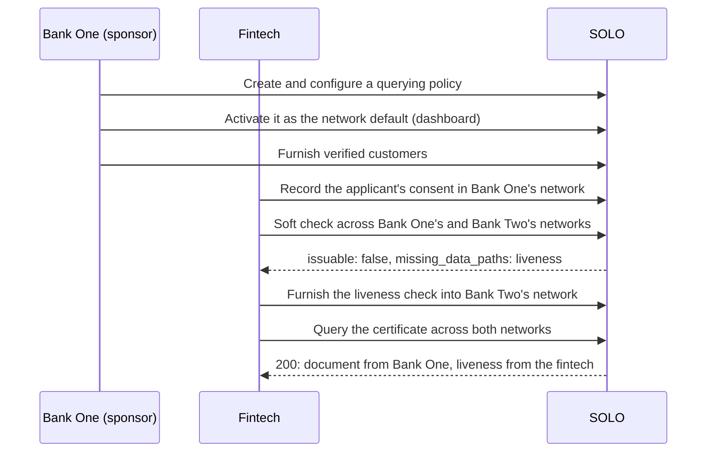

SOLO's golden path has two roles. A **sponsor bank** governs a network: it sets
the policy that certificates in its network are held to, and furnishes the
verifications it holds. A **fintech** operates inside one or more sponsor
banks' networks: it queries certificates under those policies and furnishes
what it verifies itself. A certificate is assembled from both, across every
network the fintech names.

| | Sponsor bank | Fintech |
|---|---|---|
| Role in the network | Governor | Member with the furnisher role |
| Sets the querying policy | Yes, for its own network | No; queries under its sponsor bank's |
| Furnishes verifications | Yes | Yes |
| Queries certificates | Yes | Yes, across every network it operates in |
| Golden path | [Sponsor banks](/home/golden-paths/sponsor-banks) | [Fintechs](/home/golden-paths/fintechs) |

## The rules that make it work

- **One consumer across networks.** Furnished records and consents are matched
  on SSN and date of birth, so the same person furnished in two networks is
  one consumer.
- **The first network sets the policy.** A query applies the default policy
  of the first network in `network_ids` to every network it names.
- **Every sub-product is attributed.** Each part of the certificate carries the
  `furnishing_entity_id` and `attestation_event_id` of the record it came from.
- **You read what you're entitled to.** A fintech reads its own records, its
  sponsor banks' records, and records shared with it through consent; it
  doesn't read other fintechs' records.
