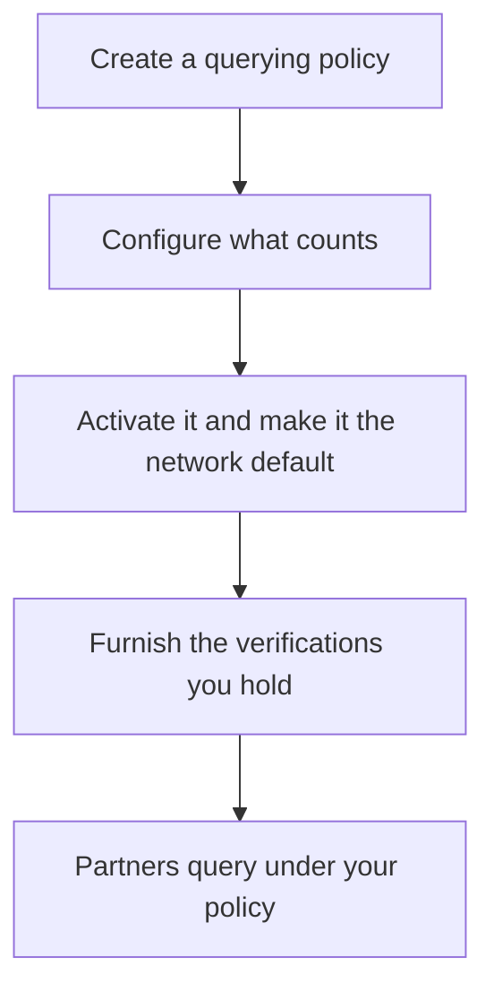

As a sponsor bank you govern a network, and your fintech partners operate
inside it as members. You decide what counts as a verification in your
network, and the verified customers you furnish are what your partners'
certificates are built from. Your partners' side of the flow is
[Golden path: fintechs](/home/golden-paths/fintechs); how the two fit together
is in the [overview](/home/golden-paths/overview).



## Prerequisites

<Note>
  - Your organization governs the network. See
    [Network roles](/concepts/governance/network-roles).
  - A sandbox API key exported as `SOLO_TOKEN`. See
    [Authentication](/home/authentication).
  - Your network's `network_id`, from the network's page in the dashboard.
</Note>

<Steps>
  <Step title="Create a querying policy">
    A [querying policy](/concepts/governance/querying-policies) is the
    standard a certificate query in your network is held to. Create one in
    your network:

    ```bash
    curl -X POST https://api.sandbox.solo.one/v1/networks/policies/querying \
      -H "Authorization: Bearer $SOLO_TOKEN" \
      -H "Content-Type: application/json" \
      -d '{
        "network_id": "9f1c0c2e-3d5b-4a89-b1e2-7f6a8c0d4e21",
        "name": "Partner KYC standard"
      }'
    ```

    ```json Response
    {
      "id": "5e7d2a14-8b3c-4f60-9e17-a2d4c6b8f015",
      "network_id": "9f1c0c2e-3d5b-4a89-b1e2-7f6a8c0d4e21",
      "entity_id": "c4a1e7d2-5b38-4f90-8e16-3d7a9b2c5f01",
      "name": "Partner KYC standard"
    }
    ```
  </Step>

  <Step title="Configure what counts">
    For each data model the policy covers, choose the conditions a furnished
    record must meet. Each condition is a provenance option, such as "the
    document was captured"; the policy editor in the dashboard lists every
    option with its ID. This example requires a captured identity document:

    ```bash
    curl -X PUT https://api.sandbox.solo.one/v1/networks/policies/querying/5e7d2a14-8b3c-4f60-9e17-a2d4c6b8f015/configuration \
      -H "Authorization: Bearer $SOLO_TOKEN" \
      -H "Content-Type: application/json" \
      -d '{
        "model_selections": [
          {
            "model_name": "DocumentCaptureEvent",
            "field_selections": [
              {
                "field_name": "is_document_captured",
                "is_enabled": true,
                "selected_provenance_option_ids": ["0b6f3e2a-9c41-4d7e-8a53-1f2e4c6d8b90"]
              }
            ]
          }
        ]
      }'
    ```

    Models the policy doesn't name keep the product's own rules. You can also
    build the whole configuration in the dashboard's policy editor instead.
  </Step>

  <Step title="Activate it and make it the network default">
    In the dashboard, open the policy and choose **Activate**, then on its
    **Assignments** tab add an enforcement window marked as the default, with
    the dates it applies.

    From then on, a certificate query that names your network first and doesn't
    pass a `policy_id` is held to this policy. Only active policies apply, and
    default windows of two active policies can't overlap.

    To offer a different policy to particular partners, add them to a window
    with **Assign members**. Those partners can then name it with `policy_id`;
    a query that names none still uses the default. Partners can't name any
    other policy of your network.
  </Step>

  <Step title="Furnish the verifications you hold">
    Contribute the verified customers your partners onboard, so their
    certificates can be built from your work instead of repeated. Each record
    is matched on SSN and date of birth, so a customer you and a partner both
    furnish is one consumer.

    ```bash
    curl -X POST https://api.sandbox.solo.one/v1/products/kyc_certificate_snapshot/furnish \
      -H "Authorization: Bearer $SOLO_TOKEN" \
      -H "Content-Type: application/json" \
      -d '{
        "network_id": "9f1c0c2e-3d5b-4a89-b1e2-7f6a8c0d4e21",
        "records": [
          {
            "first_name": "Jane",
            "last_name": "Doe",
            "date_of_birth": "1990-01-15",
            "social_security_number": "123-45-6789",
            "document_capture_events": [
              {
                "is_document_captured": true,
                "document_capture_timestamp": "2026-06-08",
                "document_capture_method": "mobile_live_capture",
                "is_document_attribute_reviewed": true,
                "document_attribute_review_timestamp": "2026-06-08",
                "document_review_method": "automated_and_manual",
                "document_review_evidence_source": "commercial_verification_provider"
              }
            ],
            "biometric_capture_events": [
              {
                "is_biometric_captured": true,
                "biometric_capture_timestamp": "2026-06-08",
                "biometric_capture_method": "live_selfie_video",
                "is_biometric_attribute_reviewed": true,
                "biometric_attribute_review_timestamp": "2026-06-08",
                "is_biometric_comparison_performed": true,
                "biometric_comparison_reference": "document_photo_same_session",
                "biometric_comparison_outcome": "full_match"
              }
            ],
            "identity_corroboration_events": [
              {
                "identity_corroboration_timestamp": "2026-06-08",
                "identity_corroboration_methods": ["credit_bureau_match"],
                "identity_corroboration_outcome": "full_match",
                "total_identity_corroboration_sources_consulted": 2,
                "is_kyc_cip": true,
                "is_ssn_match": true,
                "is_dob_match": true,
                "is_name_match": true
              }
            ],
            "address_identities": [
              {
                "line_1": "123 Main St",
                "city": "Springfield",
                "state": "IL",
                "zip": "62701",
                "country": "US",
                "address_capture_events": [
                  {
                    "is_address_captured": true,
                    "address_capture_timestamp": "2026-06-08",
                    "is_address_verified": true,
                    "address_verification_timestamp": "2026-06-08",
                    "address_verification_method_type": "credit_bureau_match",
                    "address_verification_outcome": "full_match",
                    "deliverable": true
                  }
                ]
              }
            ]
          }
        ]
      }'
    ```

    Every record is attested as furnished by your organization. When a
    partner's certificate uses it, the sub-product's `furnishing_entity_id` is
    yours.

    <Note>
      Set `is_kyc_cip` on identity corroboration events. The product's default
      rules for identity corroboration start with whether the check was part
      of your Customer Identification Program; without it, the sub-product
      can't be satisfied.
    </Note>
  </Step>
</Steps>

## What your partners can read

A partner querying your network can read the records it furnished, the records
your organization furnished, and records from institutions that granted it
access through consent. It can't read records other partners furnished. See
[Entitlement](/concepts/governance/entitlement).

## Related

<CardGroup cols={2}>
  <Card title="Golden path: fintechs" icon="mobile" href="/home/golden-paths/fintechs">
    How partners consent, check, fill gaps, and query under your policy.
  </Card>
  <Card title="Querying policies" icon="sliders" href="/concepts/governance/querying-policies">
    Everything a policy can express, and how the default is chosen.
  </Card>
</CardGroup>
