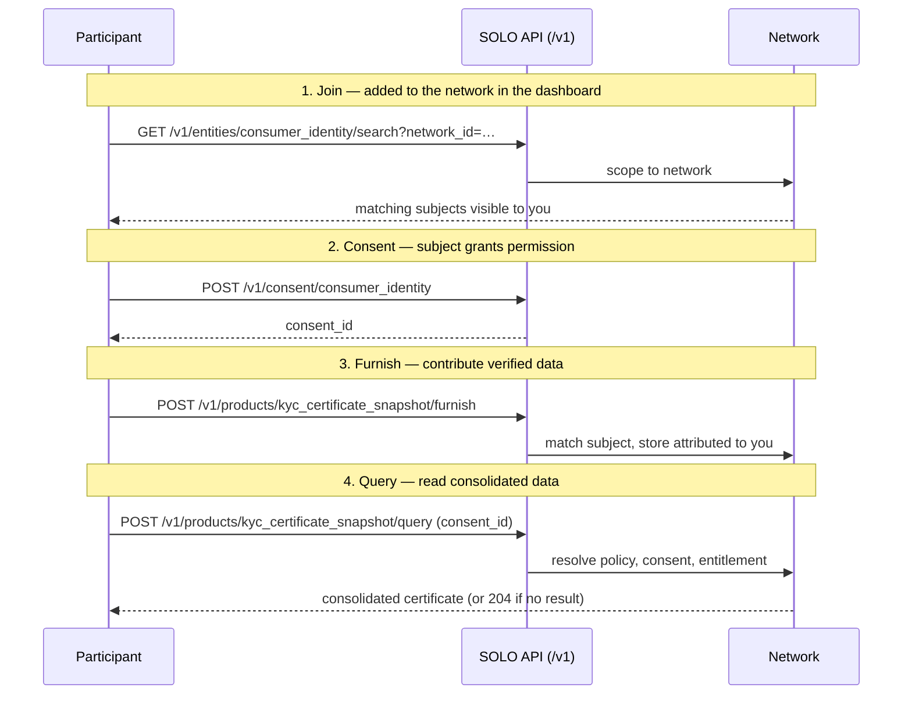

import DashboardHomeOverview from '/snippets/dashboard/home-overview.mdx';

The SOLO Network turns one institution's completed verification work into
another institution's trusted starting point. Participants furnish verified data
about consumers and businesses, and query that data back under clear rules
about who can read what. Six concepts power everything you do with the API.
Once you understand them and the order they come into play, every endpoint in
the [reference](/api-reference/introduction) reads naturally.

Each building block answers a question a bank's risk and compliance teams must
be able to answer before they reuse another institution's work:

| Building block | Question it answers |
|---|---|
| Network | Inside which group of participants does this data live? |
| Entity | Who is the subject being verified? |
| Consent | Did the subject permit this read? |
| Product | What standardized, reusable result am I asking for? |
| Policy | What must be present, and how fresh must it be, to count? |
| Entitlement | Of what the policy exposes, what may *I* see? |

Read [How SOLO is different](/home/why-solo) for why this matters, and
[Trust assets](/concepts/trust/trust-assets) for how a furnished verification
becomes something reusable.

## The building blocks

### Network

A [network](/concepts/governance/networks) is the group of participating
institutions that data is furnished into and queried from. It defines which
products are available to its members. Networks are flat — one network never
contains another. Every API call that touches data — a consent lookup, an
entity search, a furnish, a product query — names the network (`network_id`) or
networks (`network_ids`) it operates in. Within a network, each participant
holds one or more [roles](/concepts/governance/network-roles) — governor,
furnisher, querier. Membership is managed in the SOLO dashboard, not over the
REST API.

### Entity

An [entity](/concepts/identity/entities) is a subject of the network: a
**consumer** (a person) or a **business**. Every furnish writes data about a
subject, and every query reads data about one. When you furnish, the network
matches the record to an existing subject on its match key — **SSN and date of
birth** for consumers, **federal EIN and jurisdiction of formation** for
businesses — so data furnished by one bank consolidates with data furnished by
another. You can look up subjects visible to you in a network with
`GET /v1/entities/consumer_identity/search` and
`GET /v1/entities/business_identity/search`, both scoped by a required
`network_id`.

### Consent

[Consent](/concepts/identity/consent) is the subject's permission, captured as a
record. Before you query data about a consumer, you record that they agreed —
`POST /v1/consent/consumer_identity` — and receive a `consent_id` that you pass
on later queries. Business consent works the same way through
`POST /v1/consent/business_identity`.

A consent is bound to the network it was created in: a query that uses it must
include that network in `network_ids`, or it returns `404`. A consent can carry
an expiry; a query with an expired consent returns `403`. The identity fields
on a consumer consent are immutable, but `scope`, `expires_at`, and
`consented_fields` can be updated with
`PUT /v1/consent/consumer_identity/{consent_id}`. There is no revocation
endpoint — to end a consumer consent early, set its `expires_at`. The API
refuses to create a consent unless you affirm that consent was actually
gathered from the subject first.

### Product

A [product](/api-overview/querying/products) is the unit of data you furnish or
query — a standardized package rather than a raw table. The network currently
offers KYC and KYB certificates (consolidated identity-verification outcomes for
consumers and businesses) and two screening lists (a bank-specific bad-actor
list and a cross-bank financial-crimes watch list). Each product exposes a
`query` operation and, where applicable, `furnish` and `query/soft` — for
example `POST /v1/products/kyc_certificate_snapshot/query`. Two non-billable
checks help before you commit to a billable query: `POST /v1/products/check` reports per-furnisher field
[coverage](/api-overview/querying/coverage-check), and the certificate soft
checks (`POST /v1/products/kyc_certificate_snapshot/query/soft` and
`POST /v1/products/kyb_certificate_snapshot/query/soft`) report whether the
exact query would produce a certificate.

### Policy

A [querying policy](/concepts/governance/querying-policies) defines what a
product reads in a network — which models and fields appear in results, and
which conditions (values, freshness) data must meet to count. Governors create
querying policies with `POST /v1/networks/policies/querying` and configure them
with `PUT /v1/networks/policies/querying/{policy_id}/configuration`, or in the
dashboard.

A [furnishing policy](/concepts/governance/furnishing-policies) defines how
submitted files are mapped and validated on the way in. Furnishing policies are
created and configured in the dashboard; the API can list and read them.

A query can name a `policy_id`. If it doesn't, the querying policy currently
assigned to the first network in `network_ids` applies to all the networks in
the query.

### Entitlement

[Entitlement](/concepts/governance/entitlement) answers the last question: of
the fields the policy exposes, which ones can *you* see? Entitlement is earned
through participation — by furnishing data about a subject or by querying it —
and is evaluated at query time. Two participants issuing the same query about
the same subject can receive different results, each limited to what their own
participation entitles them to.

## The data flow

The building blocks come into play in a fixed order. Here is the lifecycle of a
participant from joining a network to reading its first query result:

1. **Join a network.** Your organization is added to the network in the SOLO
   dashboard and assigned roles. See
   [Join a network](/home/quickstart/join-a-network).
2. **Create consent.** Record the subject's permission and keep the returned
   `consent_id`.
3. **Furnish.** Contribute data through a product's `furnish` endpoint — or in
   bulk as [JSONL files](/api-overview/furnishing/file-upload) from the dashboard
   or over [SFTP](/api-overview/sftp/overview). For files, the network's
   furnishing policies map and validate each record.
4. **Query.** Ask a product for consolidated data, citing your `consent_id` and
   the networks to read. The result is assembled from what participants
   furnished, filtered through the querying policy and your entitlement. If the
   available data cannot satisfy the policy, you receive an empty
   `204 No Content` rather than a partial answer.

## How the pieces control access

The model is easiest to remember as three checks, each answering a different
question:

| Check       | Question it answers                     | Granted by |
| ----------- | --------------------------------------- | ---------- |
| Capability  | May you perform this operation here?    | Your [roles](/concepts/governance/network-roles) in the network |
| Permission  | Is there a basis to read this subject?  | A valid [consent](/concepts/identity/consent) record, or a query by the subject's profile ID |
| Visibility  | Which fields may you actually see?      | Your [entitlement](/concepts/governance/entitlement), within the policy's bounds |

**Roles grant capability.** Roles are assigned per network. Furnishing into a
network requires the furnisher or governor role there; without it, the furnish
returns `403`.

**Consent grants permission.** A consent record is scoped to its network,
optionally time-limited, and auditable after the fact. A query can instead name
the subject's profile ID (`consumer_identity_id` or `business_identity_id`), but
not both a consent and a profile ID.

**Entitlement grants visibility.** You see only the fields your participation
has earned, and never more than the network's querying policy exposes. The
policy is the ceiling; entitlement is your position under it.

## Where to go next

If you learn best by doing, the [Quickstart](/home/quickstart) chains the full
flow — access, consent, furnish, query — into a few `curl` commands. If you are
about to write integration code, read [Authentication](/home/authentication) to
set up your API key and [Errors](/home/errors) to handle failures correctly —
in particular the difference between a `204` empty result, a `400` rejected
operation, and a `422` malformed request.

For depth on any single building block, follow its link above into the
concepts section. If your organization primarily contributes data, continue
from [Furnishing](/api-overview/furnishing/overview) into
[JSONL files](/api-overview/furnishing/file-upload) and the
[SFTP guide](/api-overview/sftp/getting-started); if it primarily consumes data,
continue from [Querying](/api-overview/querying/overview) into the product pages
— [KYC certificate](/api-overview/querying/kyc-certificate-snapshot),
[KYB certificate](/api-overview/querying/kyb-certificate-snapshot), and
[screening lists](/api-overview/querying/screening-lists).

<DashboardHomeOverview />

<CardGroup cols={2}>
  <Card title="Querying" icon="magnifying-glass" href="/api-overview/querying/overview">
    How a query resolves across network, policy, consent, and entitlement.
  </Card>
  <Card title="Furnishing" icon="arrow-up-from-bracket" href="/api-overview/furnishing/overview">
    How contributed data is validated, stored, and made queryable.
  </Card>
</CardGroup>
