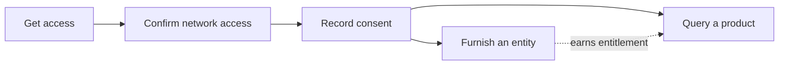

The SOLO Network lets member institutions contribute verified data about
consumers and businesses, and read consolidated results back — governed by
network membership, [consent](/concepts/identity/consent), and
[entitlement](/concepts/governance/entitlement). This page gets you
credentials and the IDs you need; the guides after it each walk through one
workflow with complete requests and responses.

## Getting access

There is no self-serve signup over the API. Your organization gets a SOLO
dashboard account and is added to networks there; everything else follows from
that.

<Steps>
  <Step title="Get a sandbox dashboard account">
    Ask your SOLO contact for a sandbox account. SOLO sets up your organization
    in the sandbox dashboard at
    [app.sandbox.solo.one](https://app.sandbox.solo.one) and adds it to one or
    more sandbox networks with the roles you need — furnisher to contribute
    data, querier to read it.
  </Step>
  <Step title="Create an API key">
    In the sandbox dashboard, open **Settings → API keys** and create a key for
    your integration. Export it so every example in these guides works as-is:

    ```bash
    export SOLO_TOKEN="<your sandbox API key>"
    ```

    See [Authentication](/home/authentication) for how keys work and how to
    rotate them.
  </Step>
  <Step title="Find your network ID and product IDs">
    - **`network_id`** — in the dashboard, open **Networks** and select your
      network. Its ID is the last segment of the page URL
      (`/networks/<network_id>`). The **Members** tab shows your
      organization's permissions in that network.
    - **`product_id`** — needed only for the coverage check
      (`POST /v1/products/check`). Open **Products** in the dashboard and
      select a product; its **Product ID** is shown at the top of the page.
    - **`policy_id`** — optional. Each querying policy's **Policy ID** is shown
      on its page under **Policies**. If you leave it out of a query, the
      querying policy assigned to the first network you query applies.
  </Step>
  <Step title="Make your first call">
    Search for consumers in your network. A `200` — even with an empty `[]`
    body — confirms your key, your organization's account, and your
    `network_id` all work:

    ```bash
    curl -G https://api.sandbox.solo.one/v1/entities/consumer_identity/search \
      -H "Authorization: Bearer $SOLO_TOKEN" \
      --data-urlencode "network_id=9f1c0c2e-3d5b-4a89-b1e2-7f6a8c0d4e21" \
      --data-urlencode "limit=10"
    ```

    A `401` means the key isn't being accepted — see the
    [troubleshooting table](/home/authentication#troubleshooting).
  </Step>
</Steps>

<Note>
  Every example in these docs uses the sandbox API,
  `https://api.sandbox.solo.one`. When you go live, create production keys in
  the production dashboard (`https://app.solo.one`) and switch the base URL to
  `https://api.solo.one`.
</Note>

## The sequence

Work through the guides in order the first time:

1. **[Join a network](/home/quickstart/join-a-network)** — how membership and
   roles work, and how to confirm your access with read-only calls.
2. **[Furnish an entity](/home/quickstart/furnish-an-entity)** — record
   consent, then contribute KYC verification data about a consumer.
3. **[Query a product](/home/quickstart/query-a-product)** — check whether a
   certificate can be issued, then read a consolidated KYC certificate back,
   including how to interpret a `200` versus a `204`.

Furnishing and querying are independent capabilities, but they reinforce each
other: furnishing data about a consumer earns you
[entitlement](/concepts/governance/entitlement) to read that consumer's data on
future queries.



The walkthroughs use the consumer-side endpoints
(`/v1/consent/consumer_identity`, `/v1/entities/consumer_identity/search`, and
the KYC certificate's `query`, `query/soft`, and `furnish`). The business-side
equivalents — `POST /v1/consent/business_identity`,
`GET /v1/entities/business_identity/search`, and the KYB certificate's
`POST /v1/products/kyb_certificate_snapshot/query`, `query/soft`, and `furnish`
— follow the same patterns; the
[fintech golden path](/home/golden-paths/fintechs#businesses-kyb)
lists them.

<Note>
  Domain errors share one envelope: a human-readable `detail` plus a
  machine-readable `error_code` (for example `PERMISSION_DENIED` or
  `RESOURCE_NOT_FOUND`). Authentication failures and malformed requests use a
  shorter `{"detail": ...}` body. See [Errors](/home/errors).
</Note>

## Choose your path

<CardGroup cols={3}>
  <Card title="Join a network" icon="sitemap" href="/home/quickstart/join-a-network">
    Understand membership and roles, and confirm your access.
  </Card>
  <Card title="Furnish your first entity" icon="arrow-up-from-bracket" href="/home/quickstart/furnish-an-entity">
    Record consent, then contribute KYC data about a consumer.
  </Card>
  <Card title="Query your first product" icon="magnifying-glass" href="/home/quickstart/query-a-product">
    Read a consolidated KYC certificate back from the network.
  </Card>
</CardGroup>

<Tip>
  New to the platform's vocabulary? Read the
  [high-level concepts](/home/overview) first. For the full endpoint catalog,
  see the [API reference](/api-reference/introduction).
</Tip>
