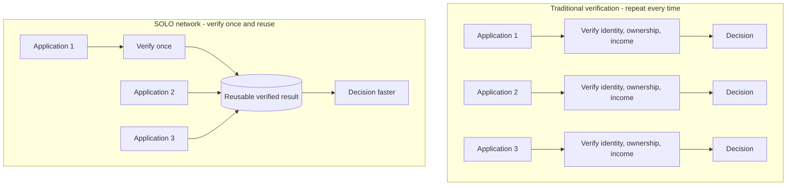
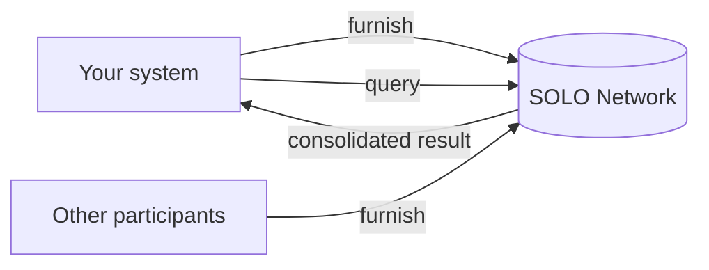

SOLO is a **reusable verification network**.

A data provider answers *"what can we discover about this business or
consumer?"* — and every institution starts that discovery from scratch. SOLO
answers a different question: *"what has already been verified about this
subject, who verified it, and can I reuse it?"* When one institution verifies a
consumer or business, that completed work becomes a **reusable, permissioned,
attributable result** that other participants can build on instead of
repeating.

> Data providers help you *verify* a business. SOLO helps you avoid *verifying
> the same business again.*

Banks and other institutions **furnish** verified data about consumers and
businesses into networks they belong to, and **query** that data back under
explicit rules about who can read what. Instead of integrating with many
verification vendors one at a time, you connect to SOLO once and work with
standardized **products** — a KYC certificate, a KYB certificate, screening
lists — inside a [network](/concepts/governance/networks) of participants. Reads
are made under the subject's [consent](/concepts/identity/consent) (or, where
you have another basis to read, by the subject's profile ID), shaped by the
network's querying policy, and limited to the fields you are
[entitled](/concepts/governance/entitlement) to see.

## Verify once, reuse everywhere

In the traditional model, every application triggers a fresh round of
verification. Three banks onboarding the same business each collect the same
documents, run the same registry lookups, and trace the same ownership. In a
SOLO network, the first verification is preserved as a reusable result; later
participants reuse it, with its provenance, and only do the work that is
genuinely missing.

See [How SOLO is different](/home/why-solo) for the full contrast with
traditional data and KYB/KYC providers.

## How the network works

Most interactions with the API are one of two operations on a product:

1. **Furnish** — contribute verified data about a
   [consumer or business](/concepts/identity/entities) into a network. Other
   participants can then query it, subject to the network's rules.
2. **Query** — read a consolidated result about a subject from one or more
   networks. A query identifies the subject by a `consent_id` (or directly by
   profile ID) and returns only the fields the querying policy exposes and you
   are entitled to read.

The product catalog covers core verification work for a bank: **KYC
certificates** consolidate identity-verification outcomes for consumers, **KYB
certificates** do the same for businesses, and two **screening lists** — a
bank-specific bad-actor list and a cross-bank financial-crimes watch list —
answer targeted risk questions. Before committing to a billable query, you can
run non-billable checks: a coverage check (`POST /v1/products/check`) shows
which furnishers hold data for a subject, and a soft check
(`POST /v1/products/kyc_certificate_snapshot/query/soft`, and the KYB
equivalent) tells you whether the exact query would produce a certificate.

The rules sit in the network itself: roles define what each participant *can*
do, policies define what each product reads, and entitlement defines what each
participant *sees*. [High-level concepts](/home/overview) walks through the
full model.

The API itself is plain REST: JSON request and response bodies, standard HTTP
status codes, and a single versioned prefix (`/v1`) for every public endpoint.
Errors follow one consistent envelope — see [Errors](/home/errors).

## Where to start

Most organizations play one or more of three roles in a network. Find yours and
follow its path.

### Network governors

You operate a network: you decide which products it offers, what each product
reads, and who participates. Start with
[Networks](/concepts/governance/networks) to understand the boundary you are
administering. Querying policies can be created with
`POST /v1/networks/policies/querying` and configured field by field with
`PUT /v1/networks/policies/querying/{policy_id}/configuration`. Furnishing
policies are created and configured in the SOLO dashboard; the API can list
them (`GET /v1/networks/policies/furnishing`) and read one
(`GET /v1/networks/policies/furnishing/{policy_id}`).

### Furnishers

You contribute data: KYC or KYB outcomes your institution has already verified.
Start with the [Furnishing overview](/api-overview/furnishing/overview), then
run the [Furnish an entity](/home/quickstart/furnish-an-entity) quickstart to
push your first record through
`POST /v1/products/kyc_certificate_snapshot/furnish`. High-volume furnishers can
deliver [JSONL files](/api-overview/furnishing/file-upload) from the dashboard
or by automated [SFTP delivery](/api-overview/sftp/overview) instead of
per-record API calls.

### Queriers

You consume data: you want a consolidated KYC certificate or a screening-list
answer for a subject you are onboarding. Start with the
[Querying overview](/api-overview/querying/overview) and
[Consent](/concepts/identity/consent), then run the
[Query a product](/home/quickstart/query-a-product) quickstart, which takes you
from `POST /v1/consent/consumer_identity` to
`POST /v1/products/kyc_certificate_snapshot/query` end to end.

<Tip>
  Not sure which role you hold? Open your network in the SOLO dashboard: the
  **Members** tab lists each member's permission. Many participants are both
  furnishers and queriers.
</Tip>

## Environments

The API is served in two environments. All public endpoints sit under the
`/v1` prefix and require a bearer credential (see
[Authentication](/home/authentication)).

| Environment | API base URL                   | Dashboard                      |
| ----------- | ------------------------------ | ------------------------------ |
| Sandbox     | `https://api.sandbox.solo.one` | `https://app.sandbox.solo.one` |
| Production  | `https://api.solo.one`         | `https://app.solo.one`         |

Sandbox and production are separate deployments with separate data. Create
sandbox API keys in the sandbox dashboard and use them against the sandbox API;
do the same for production. Every example in these docs uses the sandbox host.

Two endpoints are available without authentication for monitoring:
`GET /health` returns `{"status": "healthy"}`, and `GET /version` reports the
supported API versions and build information.

## Next steps

<CardGroup cols={2}>
  <Card title="Quickstart" icon="rocket" href="/home/quickstart">
    Get sandbox access, then furnish an entity and query a product.
  </Card>
  <Card title="High-level concepts" icon="shapes" href="/home/overview">
    Networks, entities, consent, products, policies, and entitlement — and how
    they fit together.
  </Card>
  <Card title="Security & data handling" icon="shield-halved" href="/home/security">
    Authentication, environments, data scoping, and subprocessors.
  </Card>
  <Card title="API Reference" icon="webhook" href="/api-reference/introduction">
    Endpoint-by-endpoint request and response schemas for the full `/v1`
    surface.
  </Card>
</CardGroup>
