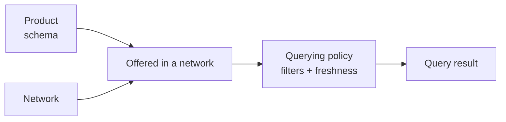

A **product** is a standardized, named data set you can **query** (read) and,
for certificate products, **furnish** (write) through the network. Every
product gives all participants a common schema for one verification domain, so
data furnished by one participant can be queried by another without bespoke
integration.

This tab is the high-level outline of each product. For request anatomy, `200`
vs `204` semantics, billing, and the `X-Ref-Id` header, see
[Network consumption](/api-overview/querying/overview).

## The catalog

SOLO offers **four queryable products** in two categories, plus a non-billable
coverage check utility.

| Product | Category | Subject | What it answers |
|---|---|---|---|
| [KYC Certificate Snapshot](/products/kyc-certificate-snapshot) | Identity Verification | Consumer | "What identity verification has been furnished for this consumer — documents, biometrics, liveness, address, and identity corroboration?" |
| [KYB Certificate Snapshot](/products/kyb-certificate-snapshot) | Identity Verification | Business | "What business verification has been furnished for this business — identity, ownership & control, and risk/compliance?" |
| [Bank-Specific Bad Actor List](/products/bank-specific-bad-actor-list) | Fraud & Financial Crime | Consumer | "Has an institution in this network placed this consumer on its bad actor list?" |
| [314(b) Cross-Bank Financial Crimes Watch List](/products/cross-bank-financial-crimes-watch-list) | Fraud & Financial Crime | Consumer | "Has a participating bank reported suspected financial-crimes activity for this consumer?" |

## Two families

| Behavior | Certificates | Lists |
|---|---|---|
| Examples | KYC Certificate Snapshot, KYB Certificate Snapshot | Bank-Specific Bad Actor List, 314(b) Cross-Bank Financial Crimes Watch List |
| What you get | A consolidated, multi-part verification result | A listing indicator plus details of the most recent listing |
| Furnishable via API | Yes — `/furnish` | No — listings arrive through the [furnishing pipeline](/api-overview/furnishing/overview) |
| Issues an artifact | Yes — `certificate_id` | No |
| Empty result | `204 No Content` | `200` with `is_listed: false` |
| Billable query event | Yes | Yes |

- **Certificates** are consolidated verification results assembled from data
  furnished by network participants. A query that resolves every part of the
  certificate *issues* a certificate for the subject; otherwise it returns
  `204 No Content`.
- **Lists** are read-only checks for listings furnished about a consumer. They
  always return `200 OK`, with a clean result expressed as `"is_listed": false`.

## The query / furnish pattern

<CardGroup cols={2}>
  <Card title="Query" icon="magnifying-glass">
    **Read** consolidated data for a subject, drawn from what participants have
    furnished to the networks you query. Requires a
    [consent](/concepts/identity/consent) ID or a direct profile reference.
  </Card>
  <Card title="Furnish" icon="arrow-up-from-bracket">
    **Contribute** verified data for a subject into a network, making it
    available to future queries in that network.
  </Card>
</CardGroup>

```text
POST /v1/products/{product}/query
POST /v1/products/{product}/furnish    (certificate products)
```

Two non-billable utilities sit alongside the product queries:

- `POST /v1/products/{kyc,kyb}_certificate_snapshot/query/soft` — a
  [soft check](/api-overview/querying/kyc-certificate-snapshot#soft-check-before-you-query)
  that runs the certificate query as a dry run and reports whether a
  certificate would be issued, without returning any subject data.
- `POST /v1/products/check` — the [coverage check](/products/coverage-check),
  which reports, per furnishing institution, which of a product's fields it has
  furnished for the subject.

## How products relate to networks and policies



A product defines *what* data exists: its models, fields, and types. A
[network](/concepts/governance/networks) lists the products it offers to its
members. A [querying policy](/concepts/governance/querying-policies) filters
which furnished records a certificate query may use, for example how recent a
verification must be. The same product can therefore produce different results
in two networks that apply different policies.

## Choosing a product

| If you need to… | Use |
|---|---|
| Reuse a consumer's furnished identity verification at onboarding | [KYC Certificate Snapshot](/products/kyc-certificate-snapshot) |
| Reuse a business's furnished verification, including beneficial owners | [KYB Certificate Snapshot](/products/kyb-certificate-snapshot) |
| Screen a consumer against bad actor listings in your sponsor bank's network | [Bank-Specific Bad Actor List](/products/bank-specific-bad-actor-list) |
| Screen a consumer for financial-crimes reports shared across banks | [314(b) Cross-Bank Financial Crimes Watch List](/products/cross-bank-financial-crimes-watch-list) |
| Know whether a certificate query would issue before paying for it | [Soft check](/api-overview/querying/kyc-certificate-snapshot#soft-check-before-you-query) |
| See which institutions have furnished which fields for a subject | [Coverage Check](/products/coverage-check) |

## Product deep dives

<CardGroup cols={2}>
  <Card title="KYC Certificate Snapshot" icon="id-card" href="/products/kyc-certificate-snapshot">
    Consolidated consumer identity verification in nine sub-products.
  </Card>
  <Card title="KYB Certificate Snapshot" icon="building" href="/products/kyb-certificate-snapshot">
    Business identity, ownership & control, and risk/compliance in one
    certificate.
  </Card>
  <Card title="Bank-Specific Bad Actor List" icon="user-xmark" href="/products/bank-specific-bad-actor-list">
    Bad actor screening within a sponsor bank's network.
  </Card>
  <Card title="314(b) Cross-Bank Financial Crimes Watch List" icon="building-shield" href="/products/cross-bank-financial-crimes-watch-list">
    Financial-crimes reports shared across participating banks.
  </Card>
  <Card title="Coverage Check" icon="list-radio" href="/products/coverage-check">
    Non-billable, per-furnisher view of which fields are on file.
  </Card>
</CardGroup>
